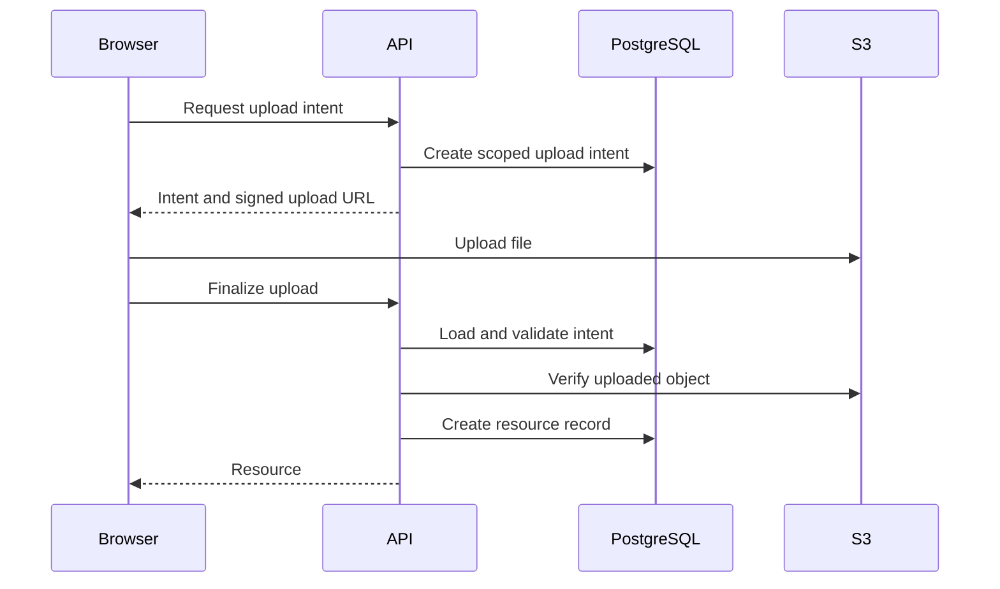
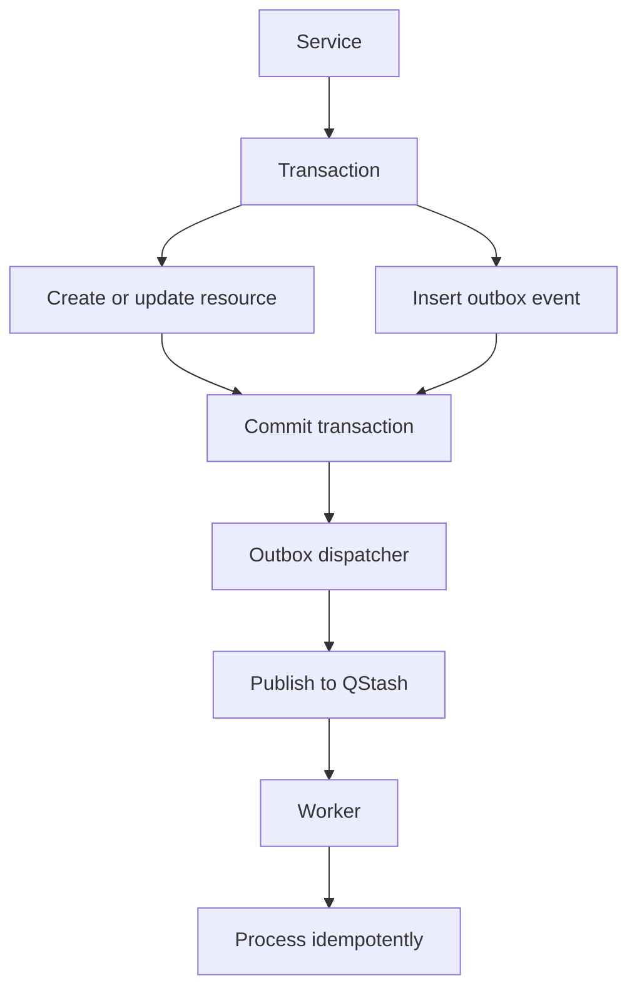
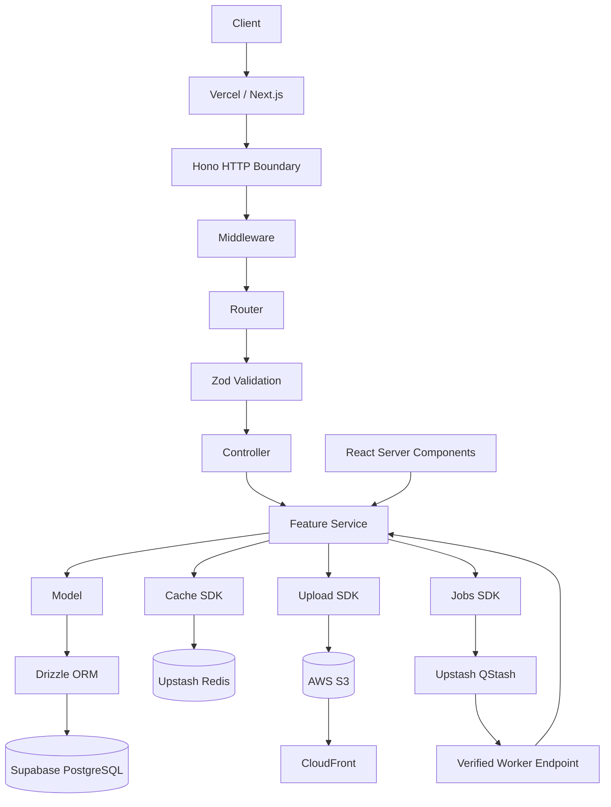

# Scalable API with Hono, Vercel, Drizzle, Supabase, Upstash

**Document type:** Engineering Architecture Specification
**Status:** Architecture Baseline
**Architecture:** Domain-oriented, modular, framework-light
**Runtime:** Next.js App Router + Vercel
**HTTP Framework:** Hono
**Database:** Supabase PostgreSQL
**ORM:** Drizzle
**Validation:** Zod
**Caching:** Upstash Redis
**Background Jobs:** Upstash QStash
**Authentication:** Supabase Auth
**File Storage:** AWS S3 + CloudFront
**Package Manager:** Bun

---

# 1. Purpose

This document defines a general-purpose architecture for building scalable APIs using Hono, Next.js, Vercel, Drizzle, Supabase, and Upstash.

The architecture is designed to be:

- Scalable and production-ready.
- Modular and domain-oriented.
- Easy for developers and coding agents to understand.
- Framework-light and easy to test.
- Suitable for dashboard applications and SaaS products.
- Compatible with Next.js App Router.
- Explicit about database access and infrastructure boundaries.
- Reusable across multiple applications.

The goal is to establish a consistent engineering architecture without building a custom framework or introducing unnecessary abstractions.

# 2. Architecture

The application uses a domain-oriented architecture with a thin HTTP boundary, framework-independent services, and reusable infrastructure SDKs.

## 2.1 HTTP request flow

```text
Client
  ↓
Vercel
  ↓
Next.js Route Handler
  ↓
Hono
  ↓
Middleware → Router → Validation → Controller
  ↓
Service
  ├── Model → Drizzle → Supabase PostgreSQL
  ├── Cache SDK → Upstash Redis
  ├── Upload SDK → AWS S3
  └── Jobs SDK → Upstash QStash
```

Hono owns HTTP routing, middleware composition, request validation integration, and HTTP responses. Vercel hosts the Next.js application and its route handlers.

## 2.2 Server Component flow

```text
React Server Component
  ↓
Feature Service
  ↓
Model
  ↓
Drizzle
  ↓
Supabase PostgreSQL
```

React Server Components call feature services directly.

They must never call the application's own HTTP API to access functionality already available within the same application.

## 2.3 Background job flow

```text
Service
  ↓
Jobs SDK
  ↓
Upstash QStash
  ↓
Worker HTTP Endpoint
  ↓
Verify Signature
  ↓
Validate Payload
  ↓
Dispatch Handler
  ↓
Feature Worker
  ↓
Service / Model / External Services
```

QStash provides managed message delivery, retries, delays, and supported scheduling capabilities.

Worker handlers are application code executed when QStash delivers a message. They are not a separate queue server.

## 2.4 System responsibilities

| Component | Responsibility |
|---|---|
| Next.js | Application framework and server-side rendering |
| Vercel | Application hosting and HTTP execution |
| Hono | HTTP routing, middleware, and request handling |
| Zod | Runtime validation |
| Supabase Auth | User identity and session authentication |
| Supabase PostgreSQL | Authoritative application data |
| Drizzle | Type-safe database access |
| Upstash Redis | Query caching and explicitly configured Redis operations |
| Upstash QStash | Background message delivery, retries, and scheduling |
| AWS S3 | Private file storage and signed file operations |
| CloudFront | Media delivery where configured |

---

# 3. Design Principles

## 3.1 Hono Is the HTTP Boundary

Hono owns HTTP concerns.

Its responsibilities include:

- Routing.
- Middleware composition.
- Request validation integration.
- Authentication context.
- HTTP response construction.
- HTTP-specific error handling.

Hono must not contain business logic.

## 3.2 Business Logic Is Framework Independent

The service layer must not depend on Hono or Next.js HTTP objects.

This allows the same business logic to be used from:

- HTTP APIs.
- Background jobs.
- Server Components.
- Scheduled tasks.
- CLI commands.
- Tests.
- Other application entry points.

Services should receive explicit input and trusted context rather than an entire HTTP request object.

Prefer:

```ts
await projectService.createProject(input);
```

Avoid:

```ts
await projectService.createProject(context);
```

unless the context is an explicitly defined, framework-independent application context.

## 3.3 Explicit Over Magical

Prefer direct imports, explicit dependencies, ordinary functions, and clear configuration.

Avoid unnecessary:

- Dependency injection containers.
- Decorator-based registration.
- Global service registries.
- Generic repository layers that merely forward Drizzle calls.
- Abstract factories without a concrete need.
- Framework-like module systems.

## 3.4 Shared Implementation, Feature-Specific Configuration

Shared SDK implementations live in `lib/`.

Feature-specific configuration, business rules, and orchestration live in `features/<feature>/`.

For example:

- `lib/crud/create-crud.ts` implements generic CRUD mechanics.
- `features/resources/resource.crud.ts` configures CRUD for resources.
- `features/resources/resource.service.ts` contains resource business rules.
- `features/resources/resource.jobs.ts` defines resource-specific background jobs.

## 3.5 PostgreSQL Is the Source of Truth

PostgreSQL owns persistent application state.

Redis is a cache, QStash is a message-delivery system, and S3 stores file objects. None of these replaces PostgreSQL as the authoritative store for application records.

---

# 4. Layer Responsibilities

## 4.1 Router

The router defines the HTTP API surface.

Example routes:

```text
GET     /resources
GET     /resources/:id
POST    /resources
PATCH   /resources/:id
DELETE  /resources/:id
```

Responsibilities:

- Define routes.
- Compose middleware.
- Connect validated requests to controllers.
- Declare route-specific validation.
- Keep the API surface easy to navigate.

The router should remain declarative.

It must not contain database queries or business logic.

## 4.2 Schema

Schemas define the structure of external input using Zod.

```text
Request
   ↓
Zod Schema
   ↓
Validated Input
   ↓
Controller / Service
```

Schemas may validate:

- Request bodies.
- Query parameters.
- Route parameters.
- Headers.
- External service payloads.
- Background job payloads.

Schema validation answers:

> Is this input structurally valid?

It does not determine whether an operation is permitted by business rules. That belongs to the service and authorization layers.

## 4.3 Controller

The controller is the HTTP adapter.

```text
HTTP Request
      ↓
Validated Input
      ↓
Service Call
      ↓
HTTP Response
```

A controller should:

1. Read validated input.
2. Read relevant trusted request context.
3. Call the appropriate service.
4. Translate the result into an HTTP response.

Controllers must not:

- Query the database directly.
- Contain business rules.
- Access Redis directly.
- Perform S3 operations directly.
- Publish jobs directly as a substitute for service orchestration.
- Implement complex workflows.

Keep controllers thin.

## 4.4 Service

The service layer contains application and business logic.

Responsibilities include:

- Business rules.
- Authorization decisions.
- Workflow orchestration.
- Transaction coordination.
- Cache decisions and invalidation.
- Coordinating models.
- Coordinating infrastructure SDKs.
- Publishing jobs where appropriate.

Example:

```text
createProject()
    │
    ├── validate business rules
    ├── verify permissions
    ├── create database record
    ├── invalidate affected caches
    └── return result
```

Services should be usable without HTTP.

## 4.5 Model

The model owns persistence operations.

Responsibilities include:

- Database queries.
- Inserts.
- Updates.
- Deletes.
- Database-specific projections.
- Relational queries.
- Transactions where appropriate.

The model communicates with Drizzle and PostgreSQL.

The model must not communicate with:

- Hono.
- Controllers.
- HTTP requests.
- Redis.
- QStash.
- S3.
- Business services.

The model answers:

> How do I persist or retrieve this data?

The service answers:

> What should the application do?

---

# 5. CRUD SDK

## 5.1 Purpose

The CRUD SDK standardizes common database operations without hiding Drizzle or weakening type safety.

The shared implementation lives in:

```text
lib/crud/create-crud.ts
```

Feature-specific configuration lives in:

```text
features/resources/resource.crud.ts
```

## 5.2 Supported operations

The SDK should support the following where appropriate:

- Create.
- Paginated list.
- Get by ID.
- Update.
- Delete.
- Configured filtering.
- Configured sorting.
- Search.
- Optional read-through caching.
- Cache invalidation after mutations.

## 5.3 Responsibilities

The shared SDK owns generic mechanics:

- Common operation contracts.
- Input normalization.
- Pagination behavior.
- Validation integration.
- Consistent results and errors.
- Reusable cache integration.

Feature-specific configuration defines:

- The model or query adapter.
- Create and update schemas.
- Writable fields.
- Supported filters.
- Allowed sorting fields.
- Ownership and tenant scopes.
- Cache policy.

Illustrative configuration:

```ts
export const resourceCrud = createCrud({
  model: resourceModel,
  schema: {
    create: createResourceSchema,
    update: updateResourceSchema,
  },
  cache: {
    ttl: 60,
  },
});
```

This illustrates the intended API. Its exact TypeScript signatures must be implemented against the selected Drizzle table types and Zod schemas.

## 5.4 Create

The create operation should:

1. Validate input.
2. Accept only permitted fields.
3. Apply server-owned fields such as owner ID and timestamps.
4. Enforce database constraints.
5. Return the created record.

Never allow clients to assign protected fields simply because they exist in a database table.

## 5.5 List

The list operation should support:

- Pagination.
- Configured filters.
- Configured sorting.
- Search where supported.
- Ownership and tenant scoping.
- Consistent pagination metadata.

Sorting and filtering must use explicit allowlists. Never interpolate arbitrary client-provided column names into SQL.

Use stable ordering with a tie-breaker such as the record ID.

Offset pagination is appropriate for many moderate datasets. Use cursor pagination when large datasets or frequently changing results require it.

## 5.6 Get by ID

The database query must apply the appropriate ownership or tenant scope.

Do not fetch an arbitrary record and rely only on the frontend to prevent unauthorized access.

## 5.7 Update and Delete

Updates must validate writable fields and apply authorization scopes to the database operation.

Deletes must enforce ownership and referential constraints.

When deletion also requires S3 cleanup, use a retryable cleanup job or an outbox where reliability matters. PostgreSQL and S3 do not share an atomic transaction.

## 5.8 Complex operations

Do not force every database operation into generic CRUD.

Use explicit model and service methods for:

- Complex joins.
- Specialized search.
- Relational mutations.
- Bulk operations.
- Workflow-specific state transitions.
- Queries requiring specialized authorization.
- Operations spanning multiple tables.

The SDK should simplify common cases without limiting the feature.

---

# 6. Dependency Direction

Dependencies must flow in one direction.

```text
Router
  ↓
Controller
  ↓
Service
  ├── Model → Drizzle → PostgreSQL
  ├── Cache SDK → Upstash Redis
  ├── Upload SDK → AWS S3
  └── Jobs SDK → Upstash QStash
```

React Server Components use a direct path:

```text
RSC → Service → Model → Drizzle → PostgreSQL
```

Workers use the same application layer:

```text
QStash
  ↓
Worker Endpoint
  ↓
Worker Handler
  ↓
Service
  ↓
Model
```

Avoid these dependencies:

```text
Controller → Model
Controller → Drizzle
Router → Database
Model → Service
Model → Hono
Model → Redis
Service → Hono Context
RSC → Own HTTP API
```

Services may orchestrate infrastructure through shared SDKs. Models remain focused on persistence.

Shared SDK implementations must not import feature-specific business logic.

---

# 7. Recommended Project Structure

```text
src/
├── app/
│   └── api/
│       ├── [[...route]]/
│       │   └── route.ts
│       └── internal/
│           └── jobs/
│               └── resources/
│                   └── route.ts
│
├── api/
│   ├── app.ts
│   └── middleware/
│       ├── auth.ts
│       ├── rate-limit.ts
│       ├── request-id.ts
│       └── error-handler.ts
│
├── features/
│   └── resources/
│       ├── resource.schema.ts
│       ├── resource.types.ts
│       ├── resource.model.ts
│       ├── resource.crud.ts
│       ├── resource.upload.ts
│       ├── resource.jobs.ts
│       ├── resource.worker.ts
│       ├── resource.service.ts
│       ├── resource.controller.ts
│       ├── resource.router.ts
│       └── resource.test.ts
│
├── db/
│   ├── index.ts
│   ├── schema/
│   └── migrations/
│
├── lib/
│   ├── crud/
│   │   └── create-crud.ts
│   ├── cache/
│   │   ├── cache.ts
│   │   ├── cache.client.ts
│   │   └── cache.types.ts
│   ├── upload/
│   │   ├── upload.ts
│   │   ├── upload.client.ts
│   │   └── upload.types.ts
│   ├── auth/
│   │   ├── auth.middleware.ts
│   │   └── permissions.ts
│   ├── jobs/
│   │   ├── jobs.ts
│   │   ├── jobs.client.ts
│   │   ├── jobs.types.ts
│   │   └── jobs.signature.ts
│   ├── errors/
│   │   └── app-error.ts
│   └── logger/
│       └── logger.ts
│
├── app.ts
└── env.ts
```

This is a reference structure. Do not create every file in every feature if it does not need it.

## 7.1 Shared SDK and feature conventions

- Shared SDK mechanics live in `lib/`.
- Feature-specific configuration and orchestration live in `features/<feature>/`.
- Drizzle table definitions and migrations live in `db/`.
- Next.js Route Handlers provide HTTP runtime entry points.
- Hono remains the HTTP boundary for API routes.
- Internal worker routes verify and dispatch QStash deliveries.

For example, `lib/crud/create-crud.ts` implements generic CRUD mechanics, while `features/resources/resource.crud.ts` configures them for resources.

## 7.2 Resource-oriented organization

Organize API functionality by domain or resource rather than by technical type.

Prefer:

```text
features/
├── users/
├── projects/
├── organizations/
├── invoices/
└── subscriptions/
```

Avoid organizing the entire application into unrelated global folders such as:

```text
controllers/
models/
services/
schemas/
routers/
```

A resource's related code should remain together.

Example:

```text
features/users/
├── user.schema.ts
├── user.model.ts
├── user.service.ts
├── user.controller.ts
└── user.router.ts
```

Add CRUD, upload, or job configuration files only when the feature needs them.

---

# 8. Hono + Vercel

Hono runs within the Next.js application and provides the HTTP framework.

For Next.js applications, mount Hono through a catch-all Route Handler:

```text
src/
└── app/
    └── api/
        └── [[...route]]/
            └── route.ts
```

The general request path is:

```text
Client
  ↓
Vercel
  ↓
Next.js Route Handler
  ↓
Hono
  ↓
Middleware
  ↓
Router
  ↓
Validation
  ↓
Controller
  ↓
Service
```

## 8.1 Responsibilities

Next.js and Vercel handle application hosting and HTTP execution.

Hono handles API routing and HTTP middleware.

The service layer remains independent of both.

## 8.2 Runtime considerations

Do not assume every API or dependency can run in every Vercel runtime.

Choose the runtime based on the actual dependencies and workload. Database drivers, Node.js APIs, long-running operations, and external integrations may impose runtime constraints.

Background tasks must fit the execution limits of the selected environment. Long-running or resource-intensive processing may require a different execution environment.

## 8.3 Route handler

The Next.js route handler should remain a thin adapter that exposes the Hono application through the supported HTTP methods.

Avoid putting business logic inside the Next.js Route Handler.

---

# 9. Middleware Architecture

Middleware handles concerns that apply across multiple HTTP routes.

Examples include:

- Authentication.
- Rate limiting.
- Request IDs.
- Error handling.
- Logging.
- Request context.

Middleware should not contain resource-specific business logic.

## 9.1 Authentication

Authentication middleware establishes a trusted user identity.

Responsibilities:

1. Read the supported session or bearer credential.
2. Verify it using a trusted Supabase Auth mechanism.
3. Establish the request's authenticated user context.
4. Reject invalid credentials on protected routes.

Do not trust a user ID or role supplied only in a request body or query parameter.

Public routes should be explicitly defined rather than accidentally bypassing authentication.

## 9.2 Rate limiting

Rate limiting should protect expensive or abuse-prone operations.

Potential targets include:

- Authentication-related endpoints.
- Public API endpoints.
- Upload-intent creation.
- Resource creation.
- Expensive searches.
- Operations that invoke external services.

Use an appropriate Upstash-backed rate-limiting implementation where distributed rate limits are needed.

Rate-limit keys must reflect the correct identity or scope, such as a verified user, tenant, or IP address. Do not rely on untrusted forwarded headers without a trusted proxy configuration.

Rate limiting is distinct from query caching. They solve different problems and should remain separate concerns.

## 9.3 Request IDs

Assign or propagate a request ID at the HTTP boundary.

Use it to correlate logs across middleware, controllers, services, and external calls.

When background jobs originate from an API request, propagate a correlation ID where useful so that the originating request and later job execution can be connected.

Do not log secrets or full sensitive payloads.

---

# 10. Error Architecture

Use a shared application error abstraction.

Errors should be predictable and independent of HTTP response construction.

Suggested categories:

| Error | Meaning |
|---|---|
| `ValidationError` | Input failed validation |
| `AuthenticationError` | Identity could not be verified |
| `AuthorizationError` | The caller lacks permission |
| `NotFoundError` | The permitted resource was not found |
| `ConflictError` | A uniqueness or state conflict occurred |
| `RateLimitError` | The operation is rate-limited |
| `ExternalServiceError` | An external dependency failed |
| `InternalError` | An unexpected application failure |

An `AppError` can carry a stable error code, safe message, and relevant status classification.

Do not expose database internals, stack traces, credentials, signed URLs, or signing keys to clients.

## 10.1 Error ownership

- Schemas report structural validation failures.
- Services report business-rule failures.
- Models and database constraints enforce persistence integrity.
- SDKs classify external infrastructure failures.
- Controllers and the global error handler translate errors into HTTP responses.
- Worker boundaries translate processing outcomes into responses consistent with the configured QStash retry policy.

---

# 11. Global Error Handler

Use a centralized Hono error handler for HTTP errors.

The handler should:

1. Recognize known application errors.
2. Return a consistent response format.
3. Log unexpected failures with a request ID.
4. Avoid leaking internal details.
5. Preserve the correct HTTP status code.
6. Distinguish client errors from retryable infrastructure failures.

Example response shape:

```json
{
  "error": {
    "code": "RESOURCE_NOT_FOUND",
    "message": "Resource not found",
    "requestId": "request-id"
  }
}
```

This is an illustrative response contract. The implementation should use the project's actual shared error definitions.

Do not catch every error inside every controller just to repeat the same response logic.

The global error handler should handle unexpected HTTP failures. Background worker endpoints still need delivery-aware error handling because returning a success response for failed work can prevent QStash retries.

---

# 12. Validation

Use Zod to validate external input at the system boundary.

Validate:

- Route parameters.
- Query parameters.
- Request bodies.
- Headers where relevant.
- External service payloads.
- QStash job payloads.

Do not treat TypeScript types as runtime validation.

Use separate schemas where create, update, and query inputs have different requirements.

Example:

```text
resource.schema.ts
├── createResourceSchema
├── updateResourceSchema
├── resourceIdSchema
└── listResourcesSchema
```

Keep schemas close to the feature that owns them.

Validation must not replace authorization or business validation. A structurally valid request can still be unauthorized or invalid under business rules.

---

# 13. Cache SDK — Upstash Redis

## 13.1 Purpose

Caching belongs at the application/service layer, not inside models.

```text
Service
  ├── Cache SDK → Upstash Redis
  └── Model → Drizzle → PostgreSQL
```

Use cache-aside behavior:

1. Generate a deterministic cache key.
2. Read from Redis.
3. Return a valid cached value on a hit.
4. Query the model on a miss.
5. Cache the result with a configured TTL.
6. Return the result.

Illustrative interface:

```ts
const resources = await cache.getOrSet({
  key: `resources:list:${scopeHash}`,
  ttl: 60,
  fetcher: () => resourceModel.list(input),
});
```

The shared Cache SDK provides caching mechanics. Feature services decide what to cache and when.

## 13.2 Cache keys and authorization

Keys must account for all inputs that affect the result:

- Tenant or ownership scope.
- Filters.
- Sorting.
- Pagination.
- Search query.
- Visibility rules.
- Other relevant query parameters.

Never include access tokens or secrets in cache keys.

Cache entries must not leak data between users or tenants.

Example namespaces:

```text
resources:item:{resourceId}
resources:public:{slug}
resources:list:{scopeHash}
```

The key-generation strategy must normalize query inputs consistently.

## 13.3 Invalidation and failures

Successful mutations must invalidate or version the affected detail, list, search, and public lookup entries.

Redis is an optimization, not the source of truth.

- Cache read failures may fall back to PostgreSQL where safe.
- Cache write failures should not discard a successful database result.
- Invalidation failures must be observable.
- Sensitive or correctness-critical data must not remain stale indefinitely.

Cache invalidation is not automatically atomic with a PostgreSQL transaction. Workflows requiring stronger consistency must define a deliberate invalidation or versioning strategy.

The model remains unaware of Redis.

---

# 14. Infrastructure SDKs

External infrastructure should be accessed through small shared SDKs. Shared implementations live in `lib/`; feature-specific configuration remains inside the relevant feature.

## 14.1 CRUD SDK

The CRUD SDK standardizes common database operations while retaining Drizzle's type safety.

It can provide create, paginated list, get by ID, update, delete, and configured filtering, sorting, and search.

Feature configuration defines schemas, allowed fields, supported filters, query scopes, and cache behavior.

Complex joins, specialized queries, and business workflows remain explicit model and service methods.

## 14.2 Upload SDK — AWS S3

The Upload SDK provides:

- Signed upload URLs.
- Signed download URLs.
- Object verification.
- Object deletion.
- Multipart upload operations where needed.

The browser uploads directly to S3 using a short-lived signed URL. The application remains responsible for authorization, upload intent, verification, and database state.

### Upload lifecycle



### Upload intent requirements

An upload intent should track:

- Intent ID.
- Owner or tenant.
- Server-generated object key.
- Expected content type and size constraints.
- Expiration.
- Status.
- Associated resource ID where appropriate.

An object-key prefix alone does not prove ownership.

At finalization, verify that the intent belongs to the caller, remains valid, and has not already been consumed. Verify that the object exists and meets applicable constraints.

Declared content type and S3 metadata do not prove that a file's actual contents match the declaration. Inspect content where file type or safety matters.

### Storage security

- Keep buckets private by default.
- Generate object keys on the server.
- Use short-lived signed URLs.
- Enforce upload limits.
- Authorize downloads before issuing signed URLs.
- Never expose AWS credentials to the browser.
- Prevent cross-user and cross-tenant access.

### Multipart uploads

For sufficiently large files, support multipart upload initialization, signed part URLs, completion, and abort operations.

Validate ownership of the upload intent and multipart upload before completion. Clean up incomplete uploads through an explicit lifecycle or cleanup process.

### Storage cleanup

PostgreSQL and S3 do not share an atomic transaction.

Use a retryable cleanup job or transactional outbox when deletion must be reliable. Track cleanup state so failed operations can be retried safely.

## 14.3 Jobs SDK — Upstash QStash

The Jobs SDK standardizes asynchronous work publication.

Responsibilities include:

- QStash client initialization.
- Typed job publishing.
- Job payload validation.
- Delivery signature verification.
- Job registration and dispatch.
- Retry configuration.
- Delay and schedule configuration where supported.
- Shared error handling.

Feature-specific job names, payload schemas, handlers, and publishing functions belong in the feature.

Example intended interface:

```ts
await jobs.publish("resources.process", {
  resourceId,
});
```

The implementation must map this interface to the installed QStash SDK and its supported options.

QStash credentials and signing keys must remain server-only.

## 14.4 Worker SDK

Workers execute registered feature handlers when QStash delivers messages.

Example intended registration:

```ts
export const resourceWorker = createWorker({
  "resources.process": processResource,
  "resources.cleanup": cleanupResources,
});
```

The shared worker implementation should:

1. Verify the QStash signature.
2. Validate the delivered message.
3. Validate the job type and payload.
4. Dispatch to the registered handler.
5. Return a response consistent with the configured retry policy.

Worker handlers call feature services rather than duplicating business logic.

QStash may deliver a message more than once. Exactly-once execution must not be assumed.

Handlers must be idempotent wherever side effects can be repeated.

## 14.5 Reliable job publication

Publishing a QStash message and committing a PostgreSQL transaction are separate operations.

If losing a job is unacceptable, use a transactional outbox.



The business change and outbox event are written in the same PostgreSQL transaction.

A dispatcher publishes pending events and retries failures. If publication succeeds but recording success fails, the event may be published again. Workers must therefore remain idempotent.

The outbox is an application reliability mechanism; QStash does not provide it automatically.

## 14.6 Authentication and authorization

Supabase Auth establishes identity.

Authentication middleware verifies credentials and establishes trusted request context.

Authorization combines action-level permissions with record-level ownership or tenant scoping.

Example permissions:

```text
resource.read
resource.create
resource.update
resource.delete
resource.upload
```

Never trust roles or user IDs supplied only by the client.

Supabase Row Level Security can provide an additional protection layer when correctly configured. Drizzle does not automatically enforce RLS merely because the database is hosted by Supabase. Connection identity, PostgreSQL roles, and transaction context must be configured intentionally. Privileged credentials may bypass RLS.

---

# 15. Database Architecture

The database access path is:

```text
Service
  ↓
Model
  ↓
Drizzle
  ↓
Supabase PostgreSQL
```

Drizzle is the application's database access layer.

Avoid mixing multiple ORMs or allowing controllers, routers, and random utilities to issue database queries.

PostgreSQL is the source of truth for persistent application data. Redis is a cache, and QStash is a delivery mechanism; neither replaces database state.

Use database constraints for:

- Uniqueness.
- Referential integrity.
- Required fields.
- Valid state relationships where appropriate.

Apply ownership and tenant scopes in database queries.

Where RLS is used, configure the database role and request or transaction context intentionally.

For workflows requiring reliable asynchronous publication, an outbox table can persist pending events in the same transaction as the associated data change.

---

# 16. API Response Design

API responses should be consistent across resources.

Use a predictable response structure for successful results and a consistent error structure for failures.

Illustrative successful response:

```json
{
  "data": {
    "id": "resource-id",
    "name": "Example resource"
  }
}
```

Illustrative list response:

```json
{
  "data": [],
  "pagination": {
    "page": 1,
    "pageSize": 20,
    "total": 0
  }
}
```

Illustrative error response:

```json
{
  "error": {
    "code": "RESOURCE_NOT_FOUND",
    "message": "Resource not found",
    "requestId": "request-id"
  }
}
```

These examples define a possible response convention. The implementation should use the project's established response contract consistently.

Avoid exposing database records indiscriminately. Return only fields permitted by the API contract.

Use appropriate HTTP status codes and avoid returning internal error details.

---

# 17. Testing Strategy

Testing should validate both individual components and complete application workflows.

## 17.1 Integration tests

Integration tests are the primary layer for verifying API behavior.

Cover:

- Request validation.
- Authentication and authorization.
- CRUD operations.
- Pagination, filtering, sorting, and search.
- Ownership and tenant isolation.
- Cache invalidation.
- Upload intent creation and finalization.
- Job publication and worker processing.
- Error response consistency.

Test behavior at the actual boundaries rather than asserting implementation details unnecessarily.

## 17.2 Unit tests

Unit tests should cover isolated business logic and reusable SDK behavior.

Examples:

- Service business rules.
- CRUD input normalization.
- Cache key generation.
- Permission evaluation.
- Upload intent validation.
- Job payload schemas.
- Worker dispatch.
- Error classification.

Use deterministic fakes for external services where practical.

## 17.3 End-to-end tests

E2E tests should verify critical user-facing workflows.

Examples:

- Create, list, update, and delete a resource.
- Upload a file and finalize the resource.
- Request an authorized download.
- Publish a processing job and execute the handler.
- Retry a failed job without duplicating its side effects.
- Recover from failed job publication when using an outbox.

## 17.4 SDK integration test coverage

The shared SDKs should specifically cover:

- CRUD validation, pagination, sort allowlists, and scoped queries.
- Cache key isolation, invalidation, TTL behavior, and Redis failures.
- Upload intent ownership, expiration, object verification, and repeated finalization.
- Authentication and authorization failures, including cross-tenant access.
- QStash signature verification and job payload validation.
- Duplicate worker delivery and retry behavior.
- Outbox publication recovery when publication or acknowledgement fails.

Use compatible integration environments for workflows where provider behavior matters.

---

# 18. Scaffolding with Plop

Plop is the recommended scaffolding mechanism for creating new API resources consistently.

Example:

```bash
bun plop resource users
```

A generated resource may contain:

```text
features/users/
├── user.schema.ts
├── user.model.ts
├── user.service.ts
├── user.controller.ts
├── user.router.ts
└── user.test.ts
```

Additional files such as CRUD configuration, upload configuration, or job handlers should be generated only when required by the feature.

Templates may live under:

```text
templates/
└── resource/
    ├── resource.schema.ts.hbs
    ├── resource.model.ts.hbs
    ├── resource.service.ts.hbs
    ├── resource.controller.ts.hbs
    ├── resource.router.ts.hbs
    └── resource.api.test.ts.hbs
```

Plop establishes consistent structure. It is not intended to generate business logic automatically.

---

# 19. Coding Agent Compatibility

The architecture is designed for both human developers and coding agents.

Agents should reuse established patterns rather than invent new ones.

For a new resource:

1. Run Plop.
2. Review generated files.
3. Define Zod schemas.
4. Implement the model.
5. Implement the service.
6. Implement the controller.
7. Register the router.
8. Add integration tests.
9. Add SDK configuration only where needed.

Agents must preserve dependency direction.

```text
Router
  ↓
Controller
  ↓
Service
  ↓
Model
```

For Server Components:

```text
RSC
  ↓
Service
  ↓
Model
```

For background jobs:

```text
QStash
  ↓
Verified Worker
  ↓
Feature Handler
  ↓
Service
```

Agents must not introduce:

- New architectural layers without justification.
- Duplicate database access patterns.
- Unnecessary resource-specific abstractions.
- Business logic inside controllers.
- Database access inside routers.
- HTTP dependencies inside services.
- Infrastructure dependencies inside models.
- Unvalidated job payloads.
- Workers that trust unsigned requests.
- Unscoped upload keys.
- Cache behavior that bypasses authorization.

---

# 20. Code Quality Standards

Code should optimize for readability and maintainability.

## 20.1 Naming

Use descriptive names:

```ts
userId
existingUser
updatedUser
databaseConnection
isArchived
hasPermission
shouldRefresh
canDelete
```

Boolean variables should communicate intent.

Prefer:

```ts
isActive
hasPermission
canEdit
shouldRefresh
```

Avoid vague names such as:

```ts
active
permission
edit
refresh
```

## 20.2 Functions

Functions should generally have a single responsibility.

Prefer functions that are:

- Small.
- Focused.
- Predictable.
- Explicit about dependencies.
- Easy to test.

Avoid large functions that mix validation, business logic, database queries, HTTP response construction, logging, and cache management.

A function requiring many parameters should usually accept a well-defined input object.

## 20.3 Control flow

Prefer guard clauses:

```ts
if (!user) {
  throw new NotFoundError("User not found");
}

if (!user.isActive) {
  throw new AuthorizationError("User is inactive");
}

return updateUser(user);
```

Avoid deeply nested conditionals.

Avoid magic values. Use named constants where values have business meaning.

## 20.4 Explicitness

Prefer direct method calls and named dependencies over hidden behavior.

Avoid grouping unrelated operations into generic objects merely to reduce the number of exports.

Keep methods and service functions easy to locate, read, and test.

---

# 21. Formatting

Use automated formatting with Prettier.

Formatting should enforce:

- Consistent indentation.
- Consistent spacing.
- Clean imports.
- Readable line lengths.
- Predictable object formatting.
- Consistent method chaining.

Formatting should be automated rather than dependent on individual developer preference.

Run formatting and linting through the project's standard scripts and CI pipeline.

---

# 22. Documentation and Comments

Comments should explain **why**, not what the code already makes obvious.

Bad:

```ts
// Get the user.
const user = await getUser(userId);
```

Good:

```ts
// Load the existing user before mutation so ownership can be verified.
const user = await getUser(userId);
```

Avoid:

- Dead comments.
- Commented-out code.
- Debugging comments.
- Obvious comments.
- Long explanations that duplicate the implementation.

Public APIs and complex exported functionality should have concise documentation where useful.

SDK documentation should explain contracts, configuration, failure behavior, and security requirements.

---

# 23. Scalability Model

The architecture scales by keeping responsibilities isolated.

```text
                       API
                        │
              ┌─────────┴─────────┐
              ▼                   ▼
          Resource A          Resource B
              │                   │
              ▼                   ▼
           Service             Service
          ┌───┼────┐           ┌───┼────┐
          ▼   ▼    ▼           ▼   ▼    ▼
        Model Cache Jobs      Model Cache Jobs
          │                    │
          └─────────┬──────────┘
                    ▼
              PostgreSQL
```

As the system grows:

- Resources remain isolated.
- Services remain independently testable.
- Infrastructure remains replaceable.
- Middleware remains centralized.
- Database access remains predictable.
- API routing remains simple.
- Caching remains explicit.
- Background processing remains decoupled from HTTP requests.
- Critical asynchronous operations can be recovered through an outbox.
- Storage operations can be retried without compromising authorization.

The architecture should scale in complexity without scaling architectural confusion.

---

# 24. Architectural Rules

The following rules are foundational.

**Rule 1:** Hono is the HTTP boundary.

**Rule 2:** Controllers handle HTTP; services handle business logic.

**Rule 3:** Models handle persistence; they do not contain business workflows.

**Rule 4:** Drizzle is the database access layer.

**Rule 5:** Zod validates external input at runtime.

**Rule 6:** Business validation belongs in services.

**Rule 7:** Services must not depend on Hono.

**Rule 8:** Controllers must not access the database directly.

**Rule 9:** Models must not depend on services or HTTP.

**Rule 10:** Cross-cutting HTTP concerns belong in middleware.

**Rule 11:** Caching belongs at the application/service layer, not inside models.

**Rule 12:** External infrastructure belongs behind shared SDKs.

**Rule 13:** Use shared application errors by default.

**Rule 14:** Use integration tests as the primary API test layer.

**Rule 15:** Use Plop to scaffold new resources consistently.

**Rule 16:** Keep the architecture resource-oriented.

**Rule 17:** Prefer simple abstractions over premature abstraction.

**Rule 18:** Do not introduce a new architectural pattern when an existing pattern already solves the problem.

**Rule 19:** Shared SDK implementations live in `lib/`; feature-specific configuration and business behavior live in the feature.

**Rule 20:** React Server Components call services directly and never call the application's own HTTP API.

**Rule 21:** Upstash QStash delivers jobs; worker handlers validate, dispatch, and execute them idempotently.

**Rule 22:** Use a transactional outbox when asynchronous publication must be recoverable.

**Rule 23:** File uploads require a server-issued, scoped upload intent and verified finalization.

**Rule 24:** Cache keys must preserve authorization and tenant isolation.

**Rule 25:** PostgreSQL remains the source of truth for persistent application state.

---

# 25. Reference Architecture

The final architecture can be summarized as follows.



## Final Principle

> Keep the HTTP layer thin, the business layer independent, the data layer predictable, and the infrastructure replaceable.

Build the smallest implementation that satisfies these architectural contracts. Add complexity only when a concrete requirement demands it.
