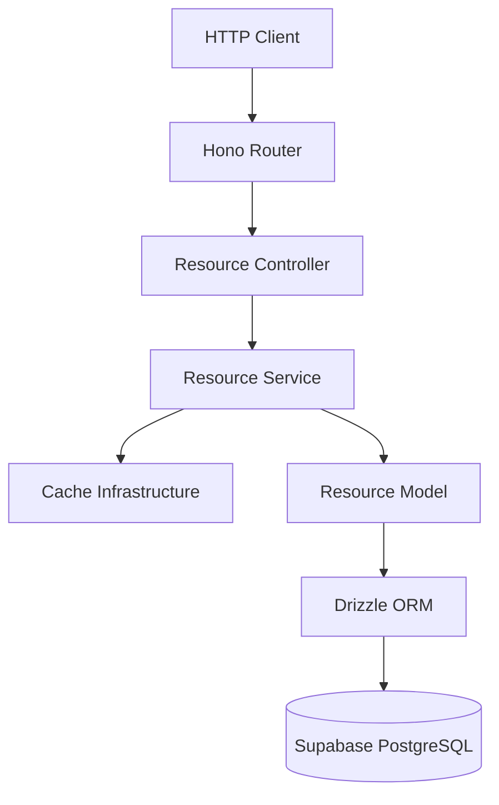
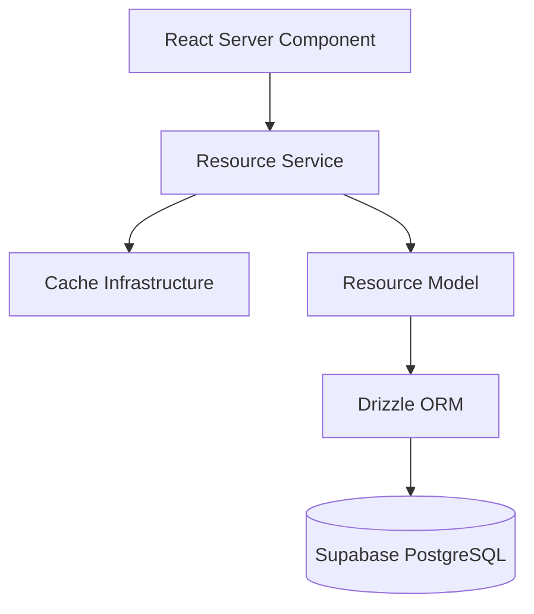
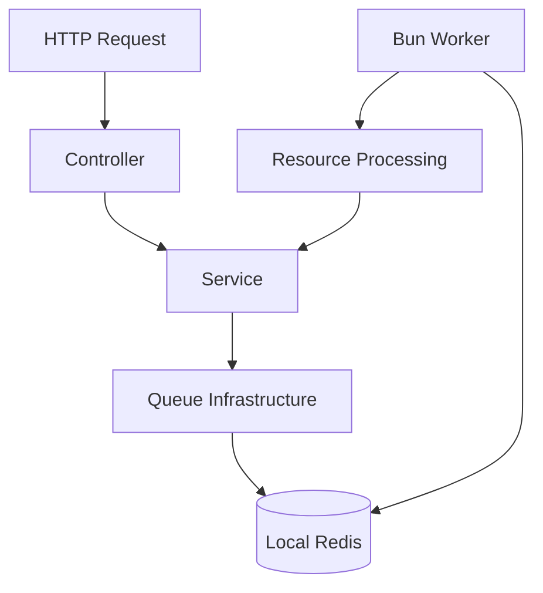

# ResourceBox --- Implementation Document

**Version:** 1.0\
**Status:** Ready for implementation\
**Purpose:** Define the target architecture, project structure,
implementation sequence, and acceptance criteria for ResourceBox.

## 1. Objective

Build ResourceBox as a local-first resource publishing application with:

-   A read-only API reference page at `app.localhost`.
-   A public resource page at `resource.localhost/:slug`.
-   A resource API implemented with Next.js, Hono, TypeScript, Bun,
    Drizzle, and local Supabase PostgreSQL.
-   Local file uploads using Supabase Storage.
-   Redis-backed query caching.
-   BullMQ background processing through a separate Bun worker.
-   Automated tests, consistent errors, structured logging, and
    documented API contracts.

This document describes the target implementation. It does not imply
that any files or features have already been created.

## 2. Non-negotiable architecture rules

1.  HTTP request flow is strictly one-way:

    `Controller → Service → Model → Drizzle → PostgreSQL`

2.  Services must not import or depend on Hono.

3.  React Server Components (RSCs) call domain services directly. They
    must never call the application's own HTTP API.

4.  Controllers handle HTTP input/output only. They do not contain
    business rules or database queries.

5.  Models own database queries and use Drizzle.

6.  Cache orchestration and invalidation belong in the service layer;
    Redis operations belong in infrastructure.

7.  The admin page is read-only. It must not execute requests, mutate
    data, or provide resource-management controls.

8.  The public page contains only the public resource experience. Do not
    expose admin controls.

9.  All development and verification must work locally. Do not require
    hosted Redis, hosted Supabase, AWS, or a CDN for local development.

10. Reproduce the supplied admin and public designs as closely as
    possible. Do not invent a replacement design.

11. Use `@hono/vercel`, not the deprecated `hono/vercel` import.

12. Validate external input at runtime with Zod.

13. Use Drizzle for all application database access.

14. Keep implementation minimal. Do not add layers, abstractions,
    dependencies, or features without a clear requirement.

## 3. Target project structure

``` text
resourcebox/
├── artefacts/
│   ├── admin-page-design.png
│   └── public-page-design.png
│
├── docs/
│   ├── engineering-doc.md
│   ├── mvp.md
│   ├── implementation-roadmap.md
│   ├── implementation.md
│   └── ui-spec.md
│
├── src/
│   ├── app/
│   │   ├── (admin)/
│   │   │   └── page.tsx
│   │   ├── (public)/
│   │   │   └── resource/
│   │   │       └── [slug]/
│   │   │           └── page.tsx
│   │   ├── api/
│   │   │   └── [[...route]]/
│   │   │       └── route.ts
│   │   ├── layout.tsx
│   │   ├── globals.css
│   │   └── not-found.tsx
│   │
│   ├── features/
│   │   └── resources/
│   │       ├── resource.schema.ts
│   │       ├── resource.model.ts
│   │       ├── resource.service.ts
│   │       ├── resource.controller.ts
│   │       ├── resource.router.ts
│   │       ├── resource.types.ts
│   │       └── resource.service.test.ts
│   │
│   ├── infrastructure/
│   │   ├── cache.ts
│   │   ├── queue.ts
│   │   ├── storage.ts
│   │   └── redis.ts
│   │
│   ├── db/
│   │   ├── index.ts
│   │   └── schema/
│   │       └── resources.ts
│   │
│   ├── lib/
│   │   ├── env.ts
│   │   ├── errors.ts
│   │   ├── logger.ts
│   │   ├── request-id.ts
│   │   └── utils.ts
│   │
│   ├── server/
│   │   ├── api.ts
│   │   └── openapi.ts
│   │
│   ├── components/
│   │   └── ui/
│   │
│   └── workers/
│       ├── resource.worker.ts
│       └── index.ts
│
├── supabase/
│   ├── config.toml
│   ├── migrations/
│   └── seed.sql
│
├── tests/
│   ├── integration/
│   │   ├── resources.test.ts
│   │   └── uploads.test.ts
│   ├── e2e/
│   │   └── routing.test.ts
│   └── smoke/
│       └── infrastructure.test.ts
│
├── templates/
│   └── feature/
│       └── resource/
│           ├── schema.ts.hbs
│           ├── model.ts.hbs
│           ├── service.ts.hbs
│           ├── controller.ts.hbs
│           └── router.ts.hbs
│
├── scripts/
│   ├── dev.ts
│   └── worker.ts
│
├── docker-compose.yml
├── Dockerfile
├── nginx.conf
├── drizzle.config.ts
├── plopfile.ts
├── vitest.config.ts
├── playwright.config.ts
├── prettier.config.ts
├── eslint.config.mjs
├── next.config.ts
├── tsconfig.json
├── package.json
├── bun.lock
├── .env.example
├── .gitignore
└── README.md
```

Create files when the relevant phase requires them. Do not create empty
placeholder modules merely to make the tree match. Keep the structure
aligned with the existing repository and its established conventions
where they do not conflict with this document.

## 4. Directory responsibilities

  -----------------------------------------------------------------------
  Location                            Responsibility
  ----------------------------------- -----------------------------------
  `src/app/`                          Next.js routes, layouts, page
                                      composition, and Hono route entry
                                      point

  `src/features/resources/`           Resource domain schemas, types,
                                      database operations, business
                                      logic, HTTP controller, and router

  `src/infrastructure/`               Redis connection, cache adapter,
                                      queue setup, and storage
                                      integration

  `src/db/`                           Drizzle client and application
                                      database schema

  `src/lib/`                          Environment validation, errors,
                                      logging, request IDs, and small
                                      shared utilities

  `src/server/`                       Hono application composition and
                                      OpenAPI document generation

  `src/components/ui/`                Reusable UI primitives only when
                                      actually needed

  `src/workers/`                      Background job processing in a
                                      separate Bun process

  `supabase/`                         Local Supabase configuration,
                                      migrations, and seed data

  `tests/`                            Integration, end-to-end, and
                                      infrastructure smoke tests

  `templates/`                        Plop templates for creating new
                                      feature modules

  `scripts/`                          Local development and worker entry
                                      scripts

  `artefacts/`                        Supplied visual design references

  `docs/`                             Architecture, requirements, UI
                                      specification, and implementation
                                      documentation
  -----------------------------------------------------------------------

## 5. Core application architecture

### 5.1 HTTP request flow



The service decides when to read or invalidate cache and when to call
the model. The model performs database operations. The controller
translates between HTTP requests/responses and service calls.

### 5.2 Server-rendered page flow



RSCs call services directly. They must not make an internal HTTP request
to the application's own Hono endpoint.

### 5.3 Background processing flow



Keep the worker independently runnable and stoppable. Do not run
long-running jobs inside ordinary HTTP handlers.

## 6. Domain and database rules

### Resource entity

Implement the initial `resources` entity with:

-   `id`: UUID primary key.
-   `name`: required text.
-   `slug`: required unique text.
-   `file_path`: nullable text referencing the stored object path.
-   `status`: enum with `pending`, `completed`, and `failed`.
-   `created_at`: timestamp.

Use the existing engineering and MVP documents to resolve any additional
required fields or constraints. Do not silently introduce extra product
behavior.

### Database implementation

-   Define the Drizzle schema in `src/db/schema/resources.ts`.
-   Keep queries in `src/features/resources/resource.model.ts`.
-   Store database migrations under the repository's chosen migration
    convention; coordinate Drizzle migrations with local Supabase rather
    than maintaining conflicting sources of truth.
-   Use Drizzle for all application database reads and writes.
-   Enforce slug uniqueness in the database and translate uniqueness
    conflicts into a stable application error.
-   Use pagination with validated parameters for list endpoints.
-   Avoid unbounded list queries.

## 7. API contract

Implement these endpoints:

  Method   Endpoint                       Purpose
  -------- ------------------------------ --------------------------------
  `GET`    `/api/health`                  Check application/API health
  `POST`   `/api/resources`               Create a resource
  `GET`    `/api/resources`               List resources with pagination
  `GET`    `/api/resources/:id`           Retrieve one resource
  `POST`   `/api/uploads`                 Initiate a file upload
  `POST`   `/api/resources/:id/process`   Enqueue resource processing

Also provide a service-level lookup by slug for the public page. The
public page uses the service directly rather than calling its own API.

For every endpoint:

-   Validate input and query parameters using Zod.
-   Return appropriate HTTP status codes.
-   Document request schemas, examples, success responses, and error
    responses in the OpenAPI specification.
-   Use a consistent JSON error envelope.
-   Never expose secrets, internal stack traces, or raw infrastructure
    errors.
-   Add request IDs to responses and logs.

Define exact response payloads in the API schemas and OpenAPI document.
The API reference page must reflect the actual API contract rather than
a separately maintained approximation.

## 8. API reference and OpenAPI

-   Generate or maintain one authoritative OpenAPI document at
    `/api/openapi.json`.
-   Prefer generating the document from the same Zod schemas and route
    definitions used by the API when supported cleanly by the selected
    libraries.
-   Do not duplicate endpoint definitions in the UI.
-   Render the API reference inside the existing admin page.
-   The admin page is a documentation viewer only.

**Explicitly prohibited in the admin UI:**

-   Request execution or "try it" controls.
-   Forms that create or edit resources.
-   Delete, update, or other mutation controls.
-   Resource-management dashboards.
-   Swagger UI or a Swagger UI integration.

The API reference must show routes, HTTP methods, paths, descriptions,
request schemas, examples, success responses, error responses, and
status codes.

## 9. Hostname routing

The application uses one Next.js app for both hostnames:

-   `app.localhost` --- read-only API reference page.
-   `resource.localhost/:slug` --- public resource page.

Use Nginx and Next.js hostname-aware routing or rewrites to map incoming
hostnames to the appropriate page. Preserve the original `Host` header
when proxying.

The Next.js route groups `(admin)` and `(public)` organize files; they
do not independently enforce hostname routing. Add explicit hostname
routing and test both hostnames.

The local routing setup must also expose the local Supabase and Redis
services at the addresses specified in `mvp.md`. Verify those addresses
against the actual local configuration rather than assuming that a
container hostname and a host-machine address are interchangeable.

## 10. Caching

Implement Redis access in `src/infrastructure/redis.ts` and cache
primitives in `src/infrastructure/cache.ts`.

Requirements:

-   Cache the resource-list query for 60 seconds.
-   Use read-through behavior: cache hit returns cached data; cache miss
    reads PostgreSQL and populates the cache.
-   Invalidate relevant cache entries after successful mutations.
-   Use stable, versionable cache keys.
-   Handle Redis read/write failures gracefully and fall back to
    PostgreSQL for reads.
-   Ensure cached data is serialized and validated safely.
-   Do not allow cache failures to turn a successful database mutation
    into an apparent failure without a clear reason.

Keep cache policy in `resource.service.ts`, not in controllers or
models. The model must remain concerned with database queries.

## 11. File uploads

Use local Supabase Storage for development.

Requirements:

-   Implement storage operations in `src/infrastructure/storage.ts`.
-   Initiate uploads through the API using a signed upload URL or the
    supported local Supabase upload-token flow.
-   Confirm the selected flow against the local Supabase Storage API
    before implementation.
-   Validate allowed file types and maximum file size on the server.
-   Keep large file bytes out of ordinary application request handlers
    where possible.
-   Store the object path in `resources.file_path` through the
    service/model flow.
-   Handle missing resources, failed uploads, and invalid files with
    consistent errors.
-   Keep local development independent of AWS S3 and CloudFront.

Do not assume a signed-URL flow works identically across SDK versions;
verify the installed Supabase SDK's supported API.

## 12. Background jobs

Use BullMQ backed by the same local Redis instance, with a dedicated key
namespace for queues.

Requirements:

-   Queue configuration belongs in `src/infrastructure/queue.ts`.
-   Worker entry point belongs in `src/workers/index.ts` or the agreed
    worker script.
-   Resource processing belongs in `src/workers/resource.worker.ts`.
-   The API enqueues work; the separate Bun worker processes it.
-   Configure retries with backoff for retryable failures.
-   Make processing idempotent so retries do not duplicate side effects.
-   Log job IDs and resource IDs.
-   Update resource processing status consistently.
-   Support graceful worker shutdown.
-   Test success, retry, repeated delivery, and permanent failure paths.

Verify BullMQ compatibility with the chosen Bun and Redis versions
before locking the runtime configuration.

## 13. Errors, request IDs, and logging

Implement shared error handling in `src/lib/errors.ts`, request ID
handling in `src/lib/request-id.ts`, and structured logging in
`src/lib/logger.ts`.

Requirements:

-   Provide a base `AppError` and specific errors for not found,
    conflict, validation, unauthorized, and forbidden cases where
    applicable.
-   Use a global Hono error handler.
-   Return a stable error shape such as:

``` json
{
  "code": "RESOURCE_NOT_FOUND",
  "message": "Resource not found",
  "requestId": "request-id"
}
```

-   Map expected errors to appropriate HTTP status codes.
-   Generate or propagate a request ID for every API request.
-   Include request IDs in logs and API responses.
-   Do not return stack traces, credentials, signed secrets, or raw
    infrastructure details.
-   Log enough context to debug failures without logging sensitive
    upload tokens or secrets.

## 14. UI implementation requirements

### Admin page

Reference: `artefacts/admin-page-design.png`.

-   Translate the design into `docs/ui-spec.md` before implementing the
    page.
-   Match layout, spacing, typography, colors, borders, method badges,
    route grouping, schema/example/response panels, and error-code
    presentation.
-   Render the API specification from the authoritative OpenAPI
    document.
-   Keep the page read-only and free of request-execution controls.
-   Do not add navigation, cards, or interactions that are absent from
    the supplied design unless required for basic navigation or
    accessibility.

### Public resource page

Reference: `artefacts/public-page-design.png`.

-   Translate the design into the same UI specification before
    implementation.
-   Resolve the resource by slug through the service layer from the
    Server Component.
-   Render only the resource information and file-access affordance
    specified by the design.
-   Handle loading, missing-resource, unavailable-file, and error states
    consistently with the design.
-   Do not expose admin actions or internal fields.
-   Ensure the public route works through `resource.localhost/:slug`.

### Design fidelity gate

Before writing page code:

1.  Inspect both PNG artifacts.
2.  Record page hierarchy, exact visible fields, dimensions/spacing,
    typography, color tokens, breakpoints, and states in
    `docs/ui-spec.md`.
3.  Compare the implemented pages against the supplied artifacts.
4.  Fix meaningful visual differences before marking the UI phase
    complete.

Do not treat a generic approximation as acceptance of the supplied
design.

## 15. Local infrastructure

Use Docker Compose and the Supabase CLI to provide local dependencies.

-   Redis runs locally and serves both caching and BullMQ.
-   Supabase CLI manages local PostgreSQL and Storage.
-   Nginx routes the two local hostnames and proxies requests.
-   Next.js and the Bun worker can run as separate processes.
-   Preserve host headers through the proxy.
-   Configure container-to-host connectivity explicitly where needed.
-   Document startup, migration, seed, test, and shutdown commands in
    `README.md`.
-   Provide `.env.example` with variable names and safe placeholders
    only.

Local development must not require hosted Redis, hosted Supabase, AWS,
or CloudFront.

## 16. Plop feature scaffolding

Provide `bun plop resource <name>` or an equivalent clearly documented
command, using `plopfile.ts` and `templates/feature/`.

The generator should create only the files needed for a new domain and
follow the project's naming conventions. Generated code must preserve
the same dependency boundaries as the resource feature.

Do not build a generalized code-generation framework. Keep the generator
small, deterministic, and tested against the expected output.

## 17. Implementation phases

### Phase 0 --- Inspect and translate designs

-   Read `docs/engineering-doc.md` and `docs/mvp.md`.
-   Inspect both design PNGs.
-   Produce `docs/ui-spec.md`.
-   Resolve the OpenAPI generation approach and upload flow based on
    installed library capabilities.

**Acceptance:** The UI spec is concrete enough to implement without
guessing, and the unresolved technical choices are documented.

### Phase 1 --- Local infrastructure

-   Configure local Supabase.
-   Add Docker Compose for Redis and Nginx.
-   Configure hostname routing and local service addresses.
-   Verify each dependency independently.

**Acceptance:** Local PostgreSQL, Storage, Redis, `app.localhost`, and
`resource.localhost` are reachable through the documented workflow.

### Phase 2 --- Application skeleton

-   Configure Next.js App Router, TypeScript, and Bun.
-   Mount Hono through `src/app/api/[[...route]]/route.ts` using
    `@hono/vercel`.
-   Implement hostname routing.
-   Add environment validation, formatting, linting, strict type
    checking, and Vitest.
-   Add the Plop scaffold.

**Acceptance:** The app starts locally, both hostnames route correctly,
and `/api/health` responds through Hono.

### Phase 3 --- Resource API

-   Add the Drizzle schema and migrations.
-   Implement Zod schemas, model, service, controller, and router.
-   Implement the documented API endpoints and public slug lookup.
-   Define the error contract and API schemas.

**Acceptance:** Endpoints work against local PostgreSQL with correct
validation, status codes, persistence, pagination, and errors.

### Phase 4 --- UI pages

-   Implement the admin API reference from OpenAPI.
-   Implement the public resource page using direct service calls.
-   Match both supplied design artifacts.

**Acceptance:** Both pages match the UI specification; the admin is
strictly read-only; the public page resolves resources by slug.

### Phase 5 --- Caching

-   Add Redis client and cache adapter.
-   Implement 60-second list caching, cache keys, invalidation, and
    fallback behavior.

**Acceptance:** Cache hit/miss behavior is verified, mutations
invalidate relevant entries, and Redis failure does not break ordinary
reads.

### Phase 6 --- Uploads

-   Integrate local Supabase Storage.
-   Implement upload initiation and file validation.
-   Associate stored object paths with resources.

**Acceptance:** A valid file can be uploaded to local Storage and
accessed through the supported resource flow; invalid uploads are
rejected.

### Phase 7 --- Background jobs

-   Configure BullMQ and the separate Bun worker.
-   Implement retry, idempotency, status updates, logging, and shutdown.

**Acceptance:** Processing can be enqueued through the API and completed
or failed by the worker, with retries and idempotency verified.

### Phase 8 --- Reliability

-   Complete centralized errors, request IDs, and structured logs.
-   Verify that responses never expose stack traces or secrets.

**Acceptance:** Expected and unexpected API failures return consistent,
safe error responses with request IDs.

### Phase 9 --- Testing and quality gates

-   Add unit tests for validation, service rules, and cache behavior.
-   Add API integration tests for success and error paths.
-   Add worker tests for retries and idempotency.
-   Add infrastructure smoke tests for PostgreSQL, Storage, Redis, and
    BullMQ.
-   Add hostname-routing and API-reference contract tests.
-   Run type checking, linting, formatting checks, and the full test
    suite.

**Acceptance:** All required checks pass from a documented local command
sequence.

## 18. Testing requirements

Cover at least these scenarios:

-   Resource creation and unique-slug conflicts.
-   Resource listing, pagination, invalid query parameters, and empty
    results.
-   Resource lookup by ID and slug, including not-found behavior.
-   Upload initiation, file type/size rejection, and storage errors.
-   Cache hit, miss, invalidation, malformed cache data, and Redis
    outage fallback.
-   Job enqueueing, successful processing, retry, duplicate delivery,
    and terminal failure.
-   Consistent error envelopes and request IDs.
-   API documentation matches actual routes and schemas.
-   `app.localhost` and `resource.localhost/:slug` routing.
-   Full local infrastructure smoke test.

Use unit tests for isolated rules, integration tests for real service
boundaries, and a small number of end-to-end tests for critical user
flows. The target distribution of approximately 30% unit, 60%
integration, and 10% E2E is a guideline, not a reason to write low-value
tests.

## 19. Definition of done

ResourceBox is complete when all of the following are true:

-   [ ] `app.localhost` displays the read-only API reference matching
    the supplied design.
-   [ ] The admin UI has no API execution, mutation, or
    resource-management controls.
-   [ ] The API reference accurately documents routes, schemas,
    examples, status codes, and errors.
-   [ ] `resource.localhost/:slug` displays the public resource matching
    the supplied design.
-   [ ] Resource data persists in local Supabase PostgreSQL through
    Drizzle.
-   [ ] Uploads work with local Supabase Storage.
-   [ ] Redis caching, TTL, invalidation, and fallback behavior are
    tested.
-   [ ] BullMQ jobs run in a separate Bun worker with retry and
    idempotency coverage.
-   [ ] Errors are consistent, safe, and include request IDs.
-   [ ] Tests and quality gates pass.
-   [ ] The documented workflow works locally without hosted
    dependencies.
-   [ ] The README explains setup, environment configuration,
    migrations, development, worker startup, testing, and shutdown.

## 20. Agent execution protocol

Implement incrementally; do not attempt to generate the entire
application in one pass.

For every phase:

1.  Read the relevant source documents and inspect the current
    repository before editing.
2.  Confirm dependencies and interfaces with adjacent phases.
3.  Implement the smallest complete vertical slice for the phase.
4.  Run the relevant tests and quality checks.
5.  Review the code for dependency direction, duplicated definitions,
    unnecessary abstractions, and missing error paths.
6.  Update documentation when behavior or commands change.
7.  Report files changed, commands run, test outcomes, known gaps, and
    the next recommended action.

Do not claim a check passed unless it was actually run. Do not silently
skip failing checks. If a required design artifact, configuration, or
library capability cannot be inspected, report the blocker and avoid
guessing.

## 21. Final constraints

-   Preserve the existing engineering and MVP specifications unless an
    explicit conflict is found.
-   When documents conflict, identify the conflict and explain the
    proposed resolution before making an architectural change.
-   Do not add authentication, authorization, product features, or
    deployment infrastructure that the MVP does not require.
-   Do not introduce Swagger UI or request-execution controls.
-   Do not move domain code into global controller/service/model
    directories.
-   Keep the `resources` feature self-contained under
    `src/features/resources/`.
-   Prefer readable, straightforward code over clever abstractions.