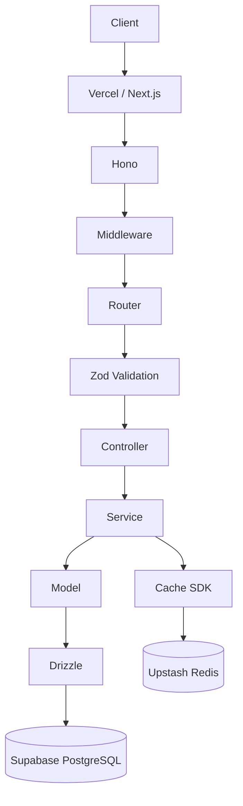
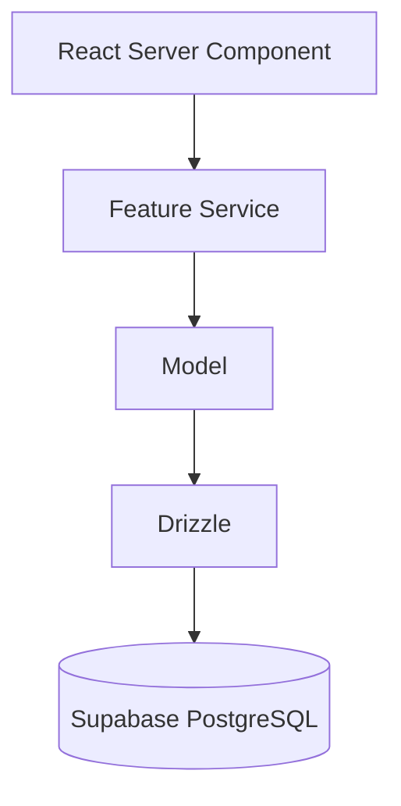
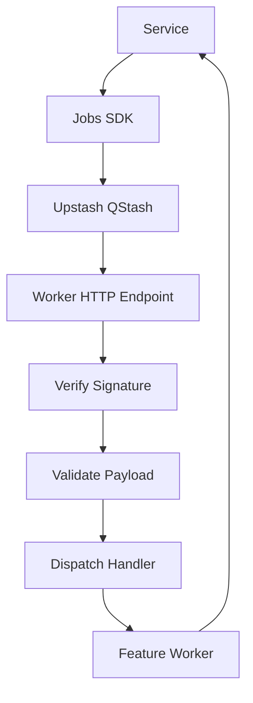

# ResourceBox — Implementation Document

**Version:** 2.0
**Status:** Architecture baseline
**Purpose:** Define the target architecture, project structure, implementation
sequence, and acceptance criteria for ResourceBox, consistent with
`docs/engineering-doc.md`.

## 1. Objective

Build ResourceBox as a resource publishing application with:

- A read-only API reference page at `app.localhost`.
- A public resource page at `resource.localhost/:slug`.
- A resource API built with Next.js App Router, Hono, TypeScript, Bun, and Zod.
- Type-safe persistence with Drizzle against Supabase PostgreSQL.
- Authentication and authorization with Supabase Auth.
- Query caching with Upstash Redis.
- Background processing with Upstash QStash.
- File storage with AWS S3 and CloudFront.
- Automated tests, consistent errors, structured logging, and documented API
  contracts.

This document describes the target implementation. It does not imply that any
files or features have already been created.

## 2. Non-negotiable architecture rules

The `docs/engineering-doc.md` rules (1–25) are foundational and apply here. The
following rules are re-stated or adapted for ResourceBox specifically:

1.  HTTP request flow is strictly one-way:

    `Controller → Service → Model → Drizzle → PostgreSQL`

2.  Services must not depend on Hono or Next.js HTTP objects.

3.  React Server Components (RSCs) call feature services directly and never call
    the application's own HTTP API.

4.  Controllers handle HTTP input/output only; they contain no business rules,
    database queries, Redis access, S3 operations, or job publication.

5.  Models own database queries and use Drizzle. They never touch Redis, QStash,
    S3, Hono, or business services.

6.  External infrastructure is accessed only through shared SDKs in `lib/`.
    Feature-specific configuration and business behavior live in `features/`.
    Shared SDK implementations must not import feature business logic.

7.  Caching belongs in the service layer through the Cache SDK, never inside
    models. Cache keys must preserve authorization and tenant isolation.

8.  The admin page is read-only. It must not execute requests, mutate data, or
    provide resource-management controls.

9.  The public page contains only the public resource experience. Do not expose
    admin controls.

10. Zod validates external input at runtime. Validation is not authorization.

11. Drizzle is the only application database access path.

12. Use shared application errors and a global Hono error handler.

13. Reproduce the supplied admin and public designs as closely as possible.

14. Use `@hono/vercel`, not the deprecated `hono/vercel` import.

15. Keep implementation minimal and explicit. Avoid DI containers, decorators,
    global registries, pass-through repository layers, and abstract factories
    without a concrete need.

16. PostgreSQL is the source of truth for persistent state; Redis is a cache,
    QStash is message delivery, and S3 stores file objects.

17. File uploads require a server-issued, scoped upload intent and verified
    finalization. Never issue unscoped object keys.

18. QStash delivers jobs; worker handlers verify the signature, validate the
    payload, and execute idempotently. Use a transactional outbox when
    asynchronous publication must be recoverable.

19. Shared SDK implementations live in `lib/`; feature-specific configuration
    and business rules live in `features/<feature>/`.

20. Keep the `resources` feature self-contained under `src/features/resources/`.

## 3. Target project structure

```text
resourcebox/
├── artefacts/
│   ├── admin-page-design.png
│   └── public-page-design.png
│
├── docs/
│   ├── engineering-doc.md
│   ├── mvp.md
│   ├── implementation-roadmap.md
│   └── design.md
│
├── src/
│   ├── app/
│   │   ├── (admin)/
│   │   │   └── page.tsx
│   │   ├── (public)/
│   │   │   └── resource/
│   │   │       └── [slug]/
│   │   │           └── page.tsx
│   │   ├── api/
│   │   │   └── [[...route]]/
│   │   │       └── route.ts
│   │   ├── internal/
│   │   │   └── jobs/
│   │   │       └── resources/
│   │   │           └── route.ts
│   │   ├── layout.tsx
│   │   ├── globals.css
│   │   └── not-found.tsx
│   │
│   ├── api/
│   │   ├── app.ts
│   │   └── middleware/
│   │       ├── auth.ts
│   │       ├── rate-limit.ts
│   │       ├── request-id.ts
│   │       └── error-handler.ts
│   │
│   ├── features/
│   │   └── resources/
│   │       ├── resource.schema.ts
│   │       ├── resource.types.ts
│   │       ├── resource.model.ts
│   │       ├── resource.crud.ts
│   │       ├── resource.upload.ts
│   │       ├── resource.jobs.ts
│   │       ├── resource.worker.ts
│   │       ├── resource.service.ts
│   │       ├── resource.controller.ts
│   │       ├── resource.router.ts
│   │       └── resource.test.ts
│   │
│   ├── db/
│   │   ├── index.ts
│   │   ├── schema/
│   │   │   └── resources.ts
│   │   └── migrations/
│   │
│   ├── lib/
│   │   ├── crud/
│   │   │   └── create-crud.ts
│   │   ├── cache/
│   │   │   ├── cache.ts
│   │   │   ├── cache.client.ts
│   │   │   └── cache.types.ts
│   │   ├── upload/
│   │   │   ├── upload.ts
│   │   │   ├── upload.client.ts
│   │   │   └── upload.types.ts
│   │   ├── auth/
│   │   │   ├── auth.middleware.ts
│   │   │   └── permissions.ts
│   │   ├── jobs/
│   │   │   ├── jobs.ts
│   │   │   ├── jobs.client.ts
│   │   │   ├── jobs.types.ts
│   │   │   └── jobs.signature.ts
│   │   ├── errors/
│   │   │   └── app-error.ts
│   │   └── logger/
│   │       └── logger.ts
│   │
│   ├── components/
│   │   └── ui/
│   │
│   ├── app.ts
│   └── env.ts
│
├── supabase/
│   ├── config.toml
│   ├── migrations/
│   └── seed.sql
│
├── templates/
│   └── resource/
│       ├── resource.schema.ts.hbs
│       ├── resource.model.ts.hbs
│       ├── resource.service.ts.hbs
│       ├── resource.controller.ts.hbs
│       ├── resource.router.ts.hbs
│       └── resource.api.test.ts.hbs
│
├── tests/
│   ├── integration/
│   │   ├── resources.test.ts
│   │   └── uploads.test.ts
│   ├── e2e/
│   │   └── routing.test.ts
│   └── smoke/
│       └── infrastructure.test.ts
│
├── docker-compose.yml
├── nginx.conf
├── drizzle.config.ts
├── plopfile.ts
├── vitest.config.ts
├── playwright.config.ts
├── prettier.config.ts
├── eslint.config.mjs
├── next.config.ts
├── tsconfig.json
├── package.json
├── bun.lock
├── .env.example
├── .gitignore
└── README.md
```

This is a reference structure. Create files only when the relevant phase needs
them; do not create empty placeholder modules merely to make the tree match.
Add SDK, CRUD, upload, or job files only when the feature requires them.

## 4. Directory responsibilities

| Location | Responsibility |
|---|---|
| `src/app/` | Next.js routes, layouts, page composition, the Hono route entry point, and internal QStash worker endpoints |
| `src/api/` | Hono application composition and cross-cutting middleware (auth, rate limit, request ID, error handler) |
| `src/features/resources/` | Resource domain: schemas, types, model, CRUD config, upload/job config, service, controller, router |
| `src/db/` | Drizzle client, table schema, and migrations |
| `src/lib/crud/` | Reusable CRUD SDK mechanics |
| `src/lib/cache/` | Upstash Redis cache SDK |
| `src/lib/upload/` | AWS S3 upload SDK |
| `src/lib/auth/` | Supabase Auth middleware and permissions |
| `src/lib/jobs/` | Upstash QStash jobs and worker SDK |
| `src/lib/errors/` | Shared application errors |
| `src/lib/logger/` | Structured logging |
| `src/components/ui/` | Reusable UI primitives, only when actually needed |
| `src/app.ts` | Application-level exports shared by entry points |
| `src/env.ts` | Environment validation |
| `supabase/` | Local Supabase configuration, migrations, and seed data |
| `templates/` | Plop templates for scaffolding features |
| `tests/` | Integration, end-to-end, and infrastructure smoke tests |
| `artefacts/` | Supplied visual design references |
| `docs/` | Architecture, requirements, UI, and implementation documentation |

## 5. Core application architecture

### 5.1 HTTP request flow



The service decides when to read or invalidate cache, when to call the model,
and when to publish jobs. The model performs database operations. The controller
translates between HTTP requests/responses and service calls.

### 5.2 Server-rendered page flow



RSCs call services directly. They must never make an internal HTTP request to the
application's own Hono endpoint.

### 5.3 Background processing flow



QStash provides managed delivery, retries, delays, and scheduling. Worker
handlers are application code executed on delivery; they are not a separate
queue server. Do not run long-running work inside ordinary HTTP handlers.

## 6. Domain and database rules

### Resource entity

Implement the `resources` entity with:

- `id`: UUID primary key.
- `name`: required text.
- `slug`: required unique text.
- `file_path`: nullable text referencing the stored object key.
- `status`: enum with `pending`, `completed`, and `failed`.
- `created_at`: timestamp.

Resolve any additional fields (e.g. ownership columns, upload-intent linkage)
against `docs/engineering-doc.md` and `docs/mvp.md`. Do not silently introduce
extra product behavior.

### Database implementation

- Define the Drizzle schema in `src/db/schema/resources.ts`.
- Keep queries in `src/features/resources/resource.model.ts`.
- Store migrations under `src/db/migrations/` and coordinate them with the local
  Supabase CLI so there is a single source of truth.
- Use Drizzle for all application database reads and writes.
- Enforce slug uniqueness in the database and translate uniqueness conflicts
  into a stable application error.
- Use pagination with validated parameters; deterministic ordering with a
  tie-breaker (e.g. `id`).
- Apply ownership or tenant scope in database queries, never only in the client.
- Use the CRUD SDK for standard operations; use explicit model/service methods
  for complex joins, specialized queries, and multi-table workflows.

## 7. API contract

Implement these endpoints:

| Method | Endpoint | Purpose |
|---|---|---|
| `GET` | `/api/health` | Check application/API health |
| `POST` | `/api/resources` | Create a resource |
| `GET` | `/api/resources` | List resources with pagination |
| `GET` | `/api/resources/:id` | Retrieve one resource |
| `PATCH` | `/api/resources/:id` | Update a resource |
| `DELETE` | `/api/resources/:id` | Delete a resource |
| `POST` | `/api/uploads` | Create an upload intent |
| `POST` | `/api/uploads/:intentId/finalize` | Finalize an upload |
| `POST` | `/api/resources/:id/process` | Enqueue resource processing |

Also provide a service-level lookup by slug for the public page. The public page
uses the service directly rather than calling its own API.

For every endpoint:

- Validate input with Zod.
- Return appropriate HTTP status codes.
- Use the consistent response envelopes defined in `docs/engineering-doc.md` §16
  (`{ "data": … }`, `{ "data": [], "pagination": … }`, `{ "error": { … } }`).
- Never expose secrets, internal stack traces, signed URLs, or raw
  infrastructure errors.
- Add request IDs to responses and logs.

Sorting and filtering must use explicit allowlists. Never interpolate arbitrary
client-provided column names into SQL.

## 8. CRUD SDK

Standard CRUD mechanics live in `src/lib/crud/create-crud.ts`. Feature-specific
configuration lives in `src/features/resources/resource.crud.ts`.

- The SDK standardizes create, paginated list, get by ID, update, delete, and
  configured filtering, sorting, and search, without hiding Drizzle or
  weakening type safety.
- Feature configuration defines the model/query adapter, create and update
  schemas, writable fields, supported filters, allowed sort fields, ownership or
  tenant scopes, and cache policy.
- Create accepts only permitted fields and applies server-owned fields (owner,
  timestamps) itself; clients cannot assign protected fields.
- List returns stable pagination metadata and applies scope/filters in the query.
- Get/update/delete apply the ownership or tenant scope in the database query.
- Complex joins, relational mutations, bulk operations, and specialized queries
  remain explicit model and service methods rather than being forced into the
  SDK.

Illustrative configuration:

```ts
export const resourceCrud = createCrud({
  model: resourceModel,
  schema: {
    create: createResourceSchema,
    update: updateResourceSchema,
  },
  cache: { ttl: 60 },
});
```

Exact TypeScript signatures are implemented against the installed Drizzle table
types and Zod schemas.

## 9. API reference page

- The admin page at `app.localhost` is a read-only documentation viewer.
- Render the reference from the project's actual schemas and route definitions
  (the same Zod schemas and route metadata used by the API), so the reference
  reflects the real contract rather than a separate approximation.
- Do not duplicate endpoint definitions in the UI.
- OpenAPI generation is optional and separate; do not add per-handler OpenAPI
  declarations or a Swagger UI unless a concrete requirement demands them.

**Explicitly prohibited in the admin UI:**

- Request execution or "try it" controls.
- Forms that create or edit resources.
- Delete, update, or other mutation controls.
- Resource-management dashboards.
- Swagger UI or a Swagger UI integration.

The reference must show routes, HTTP methods, paths, descriptions, request
schemas, examples, success responses, error responses, and status codes.

## 10. Hostname routing

The application uses one Next.js app for both hostnames:

- `app.localhost` — read-only API reference page.
- `resource.localhost/:slug` — public resource page.

Use Next.js hostname-aware routing (and a local reverse proxy such as Nginx for
development) to map incoming hostnames to the appropriate page. Preserve the
original `Host` header when proxying. In production, Vercel performs the
hostname mapping.

The Next.js route groups `(admin)` and `(public)` organise files; they do not
independently enforce hostname routing. Add explicit hostname routing and test
both hostnames.

## 11. Authentication and authorization

- Supabase Auth establishes identity; an auth middleware verifies credentials
  and establishes trusted request context.
- Never trust a user ID, role, or tenant ID supplied only in a request body or
  query parameter.
- Public routes (e.g. the public resource page and its service lookup) are
  explicitly defined.
- Authorization combines action-level permissions (e.g. `resource.read`,
  `resource.create`, `resource.update`, `resource.delete`, `resource.upload`)
  with record-level ownership or tenant scoping.
- Apply scope in the database query; use Supabase Row Level Security as an
  additional layer where configured. Drizzle does not enforce RLS automatically;
  connection identity and roles must be configured intentionally.

## 12. Caching

Implement caching through `src/lib/cache/` (Upstash Redis).

Requirements:

- Cache the resource-list query for 60 seconds using cache-aside behavior.
- Use deterministic, versionable keys that include scope, filters, sorting,
  pagination, search, and visibility rules.
- Never include access tokens or secrets in keys; keys must not leak data
  between users or tenants.
- Invalidate or version affected detail, list, search, and public lookup entries
  after successful mutations.
- Cache read failures fall back to PostgreSQL; cache write failures must not
  discard a successful database result; invalidation failures must be observable.
- Redis is an optimization, not the source of truth.

Keep cache policy in the service layer, not in controllers or models.

## 13. File uploads

Use AWS S3 (private buckets) with CloudFront for delivery where configured.

Requirements:

- Implement the Upload SDK in `src/lib/upload/`.
- Initiate uploads through `POST /api/uploads`, which creates a scoped upload
  intent and returns a short-lived signed upload URL.
- The browser uploads directly to S3; the application stays responsible for
  authorization, intent, verification, and database state.
- Generate object keys on the server; enforce upload limits; authorize downloads
  before issuing signed URLs; never expose AWS credentials to the browser.
- At finalization, verify the intent belongs to the caller, is valid and
  unconsumed, and that the object exists and meets constraints.
- Store the object key in `resources.file_path` through the service/model flow.
- Handle missing intents, failed uploads, and invalid files with consistent
  errors.
- Support multipart uploads for large files, validating ownership before
  completion.
- PostgreSQL and S3 do not share an atomic transaction; use a retryable cleanup
  job or outbox when deletion reliability matters.

## 14. Background jobs

Use Upstash QStash through the Jobs SDK in `src/lib/jobs/`.

Requirements:

- The Jobs SDK initializes the QStash client, publishes typed jobs, validates
  payloads, verifies delivery signatures, registers handlers, and configures
  retries/delays.
- Feature job names, payload schemas, handlers, and publish functions live in
  `src/features/resources/resource.jobs.ts` and `resource.worker.ts`.
- The API enqueues work (e.g. `resources.process`); QStash delivers to a worker
  HTTP endpoint under `src/app/internal/jobs/resources/route.ts`.
- The worker verifies the QStash signature, validates the payload, dispatches to
  the registered handler, and returns a response consistent with retry policy.
- Handlers call feature services; they are idempotent because QStash may deliver
  a message more than once.
- QStash credentials and signing keys remain server-only.
- When losing a job is unacceptable, persist an outbox event in the same
  PostgreSQL transaction as the data change and publish via a dispatcher.

## 15. Errors, request IDs, and logging

Implement shared errors in `src/lib/errors/`, request IDs in middleware, and
structured logging in `src/lib/logger/`.

Requirements:

- Use a shared `AppError` with categories such as `ValidationError`,
  `AuthenticationError`, `AuthorizationError`, `NotFoundError`,
  `ConflictError`, `RateLimitError`, `ExternalServiceError`, and
  `InternalError`.
- Use a global Hono error handler that returns a consistent error shape and the
  correct status code, distinguishing client errors from retryable
  infrastructure failures.
- Generate or propagate a request ID for every API request; include it in logs
  and responses; propagate a correlation ID to jobs where useful.
- Do not return stack traces, credentials, signed URLs, signing keys, or raw
  infrastructure details.
- Worker endpoints need delivery-aware error handling so failed work returns a
  response consistent with the configured QStash retry policy.

## 16. UI implementation requirements

### Admin page

Reference: `artefacts/admin-page-design.png`.

- Translate the design into `docs/design.md` before implementing the page.
- Match layout, spacing, typography, colors, borders, method badges, route
  grouping, schema/example/response panels, and error-code presentation.
- Render the API specification from the project's actual schemas and route
  definitions.
- Keep the page read-only and free of request-execution controls.
- Do not add navigation, cards, or interactions that are absent from the
  supplied design unless required for basic navigation or accessibility.

### Public resource page

Reference: `artefacts/public-page-design.png`.

- Translate the design into the same UI specification before implementation.
- Resolve the resource by slug through the service layer from the Server
  Component.
- Render only the resource information and file-access affordance specified by
  the design.
- Handle loading, missing-resource, unavailable-file, and error states
  consistently with the design.
- Do not expose admin actions or internal fields.
- Ensure the public route works through `resource.localhost/:slug`.

### Design fidelity gate

1. Inspect both PNG artifacts.
2. Record page hierarchy, exact visible fields, dimensions/spacing, typography,
   color tokens, breakpoints, and states in `docs/design.md`.
3. Compare the implemented pages against the supplied artifacts.
4. Fix meaningful visual differences before marking the UI phase complete.

Do not treat a generic approximation as acceptance of the supplied design.

## 17. Local development and infrastructure

- Supabase CLI provides local PostgreSQL and Auth.
- The Cache, Upload, and Jobs SDKs isolate the providers, so local development
  can run against local equivalents (e.g. a local Redis and a local
  S3-compatible store or Supabase Storage) behind the same interfaces, without
  changing feature code. Production targets Upstash Redis, Upstash QStash, AWS
  S3, CloudFront, and Vercel.
- A local reverse proxy (Nginx) routes `app.localhost` and
  `resource.localhost` to the Next.js process, preserving host headers.
- Document startup, migration, seed, test, and shutdown commands in `README.md`.
- Provide `.env.example` with variable names and safe placeholders only.

## 18. Plop feature scaffolding

Provide `bun plop resource <name>` (or an equivalent documented command) using
`plopfile.ts` and `templates/resource/`.

The generator creates the files a new domain needs and preserves the dependency
boundaries of the `resources` feature. Generate CRUD, upload, or job files only
when the feature requires them. Keep the generator small, deterministic, and
tested against the expected output.

## 19. Implementation phases

### Phase 0 — Inspect and translate designs

- Read `docs/engineering-doc.md` and `docs/mvp.md`.
- Inspect both design PNGs.
- Produce `docs/design.md`.
- Resolve the CRUD, upload, jobs, and cache SDK approaches against the installed
  library capabilities.

**Acceptance:** The UI spec is concrete enough to implement without guessing, and
unresolved technical choices are documented.

### Phase 1 — Local development environment

- Configure local Supabase (PostgreSQL and Auth).
- Configure hostname routing (`app.localhost`, `resource.localhost`).
- Add environment validation and the SDK provider clients with local fallbacks.
- Verify each dependency independently.

**Acceptance:** Local PostgreSQL, Auth, both hostnames, and the SDK provider
clients are reachable through the documented workflow.

### Phase 2 — Application skeleton

- Configure Next.js App Router, TypeScript, and Bun.
- Mount Hono through `src/app/api/[[...route]]/route.ts` using `@hono/vercel`.
- Implement hostname routing.
- Add environment validation, formatting, linting, strict type checking, and
  Vitest.
- Add the Plop scaffold.

**Acceptance:** The app starts locally, both hostnames route correctly, and
`/api/health` responds through Hono.

### Phase 3 — Resource domain and CRUD SDK

- Add the Drizzle schema and migrations.
- Implement Zod schemas, model, service, controller, and router.
- Implement the CRUD SDK (`lib/crud/create-crud.ts`) and the feature config
  (`resource.crud.ts`).
- Implement the documented endpoints and public slug lookup.
- Define the error contract and response envelopes.

**Acceptance:** Endpoints work against PostgreSQL with correct validation, status
codes, persistence, pagination, filters, and errors.

### Phase 4 — UI pages

- Implement the admin API reference from the project's schemas/route definitions.
- Implement the public resource page using direct service calls.
- Match both supplied design artifacts.

**Acceptance:** Both pages match the UI specification; the admin is strictly
read-only; the public page resolves resources by slug.

### Phase 5 — Authentication and authorization

- Add Supabase Auth and the auth middleware.
- Define permissions and ownership/tenant scoping.
- Apply scopes in database queries.

**Acceptance:** Protected routes reject unauthenticated/unauthorized requests,
and cross-tenant access is prevented.

### Phase 6 — Caching

- Add the Upstash Redis cache SDK.
- Implement 60-second list caching, key isolation, invalidation, and fallback
  behavior.

**Acceptance:** Cache hit/miss behavior is verified, mutations invalidate
relevant entries, and cache failure does not break ordinary reads.

### Phase 7 — Uploads

- Add the AWS S3 upload SDK and upload intents.
- Implement intent creation, signed URLs, and verified finalization.
- Associate object keys with resources.

**Acceptance:** A valid file can be uploaded to S3 and finalized through the
supported flow; invalid or unauthorized uploads are rejected.

### Phase 8 — Background jobs

- Add the Upstash QStash jobs and worker SDKs.
- Implement the worker endpoint with signature verification.
- Implement retry, idempotency, and status updates.
- Add the transactional outbox where reliable publication is required.

**Acceptance:** Processing can be enqueued through the API and completed or
failed by the worker, with retries and idempotency verified.

### Phase 9 — Reliability

- Complete centralized errors, request IDs, and structured logs.
- Verify that responses never expose stack traces, secrets, signed URLs, or
  signing keys.

**Acceptance:** Expected and unexpected failures return consistent, safe
responses with request IDs.

### Phase 10 — Testing and quality gates

- Add unit tests for validation, service rules, CRUD normalization, cache key
  generation, permissions, and worker dispatch.
- Add API integration tests for success and error paths.
- Add worker tests for retries and idempotency.
- Add SDK integration coverage (CRUD, cache, upload intent, jobs signature).
- Add hostname-routing and API-reference contract tests.
- Run type checking, linting, formatting checks, and the full test suite.

**Acceptance:** All required checks pass from a documented command sequence.

## 20. Testing requirements

Cover at least these scenarios:

- Resource create/list/get/update/delete and unique-slug conflicts.
- Pagination, filters, sorting allowlists, invalid query parameters, and empty
  results.
- Resource lookup by ID and slug, including not-found behavior.
- Authentication and authorization failures, including cross-tenant access.
- Upload intent creation, ownership, expiration, object verification, and
  repeated finalization.
- Cache hit, miss, invalidation, malformed cache data, and provider outage
  fallback.
- Job publication, signature verification, successful processing, retry,
  duplicate delivery, and terminal failure.
- Outbox publication recovery when publication or acknowledgement fails.
- Consistent error envelopes and request IDs.
- `app.localhost` and `resource.localhost/:slug` routing.

Use unit tests for isolated rules, integration tests for real service boundaries,
and a small number of end-to-end tests for critical user flows. The approximate
30% unit / 60% integration / 10% E2E distribution is a guideline, not a reason
to write low-value tests.

## 21. Definition of done

ResourceBox is complete when all of the following are true:

- [ ] `app.localhost` displays the read-only API reference matching the design.
- [ ] The admin UI has no API execution, mutation, or resource-management
      controls.
- [ ] The API reference accurately documents routes, schemas, examples, status
      codes, and errors.
- [ ] `resource.localhost/:slug` displays the public resource matching the design.
- [ ] Resource data persists in Supabase PostgreSQL through Drizzle.
- [ ] Authentication and authorization are enforced at the query boundary.
- [ ] Uploads work through scoped intents and S3 signed URLs.
- [ ] Caching (TTL, invalidation, key isolation, fallback) is tested.
- [ ] QStash jobs run through the verified worker endpoint with retry and
      idempotency coverage.
- [ ] Errors are consistent, safe, and include request IDs.
- [ ] Tests and quality gates pass.
- [ ] The README explains setup, environment configuration, migrations,
      development, worker endpoints, testing, and shutdown.

## 22. Agent execution protocol

Implement incrementally; do not attempt to generate the entire application in one
pass.

For every phase:

1. Read the relevant source documents and inspect the current repository before
   editing.
2. Confirm dependencies and interfaces with adjacent phases.
3. Implement the smallest complete vertical slice for the phase.
4. Run the relevant tests and quality checks.
5. Review the code for dependency direction, duplicated definitions,
   unnecessary abstractions, and missing error paths.
6. Update documentation when behavior or commands change.
7. Report files changed, commands run, test outcomes, known gaps, and the next
   recommended action.

Do not claim a check passed unless it was actually run. Do not silently skip
failing checks. If a required design artifact, configuration, or library
capability cannot be inspected, report the blocker and avoid guessing.

## 23. Final constraints

- Preserve the engineering and MVP specifications unless an explicit conflict is
  found.
- When documents conflict, identify the conflict and explain the proposed
  resolution before making an architectural change.
- Do not introduce Swagger UI or request-execution controls.
- Do not move domain code into global controller/service/model directories.
- Keep the `resources` feature self-contained under `src/features/resources/`.
- Shared SDK implementations live in `lib/`; feature-specific configuration and
  business behavior live in the feature.
- Prefer readable, straightforward code over clever abstractions.
