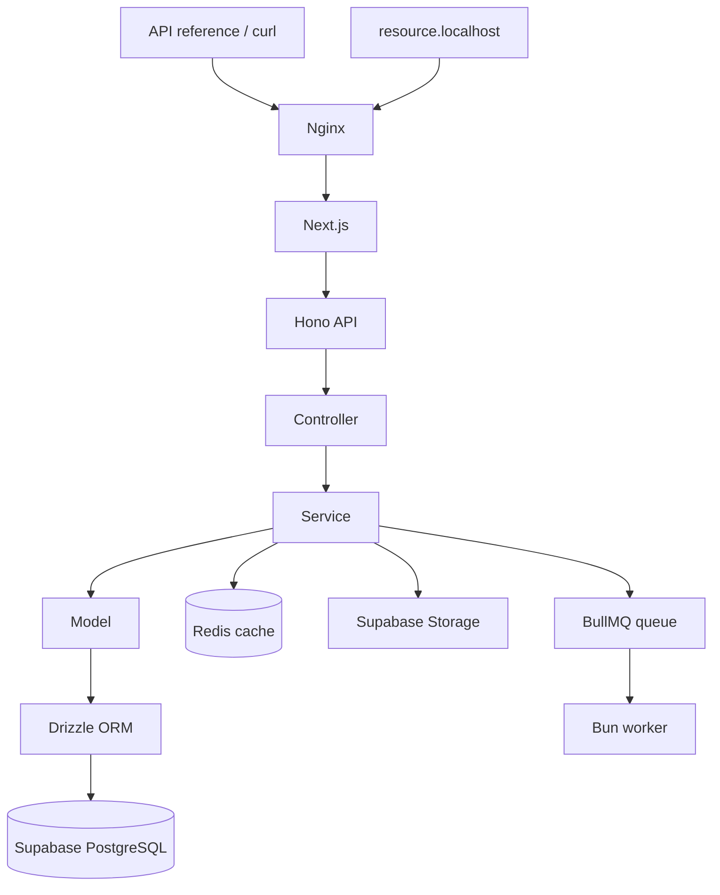

# ResourceBox — Final MVP Specification

**Version:** 1.0  
**Approach:** Local-first  
**Focus:** API architecture and backend learning

## 1. Goal

Build a small, complete backend application demonstrating a clean, scalable API architecture using Next.js, Hono, Supabase, Drizzle, Redis, and BullMQ.

The application has two pages:

- `app.localhost` — A minimal, read-only API reference using the existing admin page UI.
- `resource.localhost/:slug` — A public resource page.

There is no admin dashboard, resource-management interface, or interactive API console. The focus is learning how APIs, database access, caching, file uploads, background jobs, error handling, and testing fit together.

## 2. Application Overview

### `app.localhost` — Read-only API Reference

Use the existing admin page UI with its established dark theme and minimal design.

The page displays:

- All registered API routes.
- HTTP methods and endpoint paths.
- Request parameters and validation schemas.
- Example request bodies.
- Example success and error responses.
- Expected HTTP status codes.
- Relevant descriptions for each endpoint.

**The page is read-only.** It documents the API but does not execute requests, mutate resources, upload files, or manage background jobs.

Do not build a new documentation interface or add interactive API-testing functionality. Keep the existing page and its design principles.

### `resource.localhost/:slug` — Public Resource

A clean, minimal public page for viewing a resource by its unique slug.

It displays resource information and provides access to the associated file when available. It contains no administrative controls.

### Backend — API and Processing

Hono routes, Zod validation, service logic, Drizzle database access, Redis caching, Supabase Storage, and a separate background worker.

## 3. Technology Stack

| Concern | Technology |
|---|---|
| Application | Next.js App Router, React Server Components |
| Language/runtime | TypeScript, Bun |
| HTTP API | Hono with `@hono/vercel` |
| API specification | OpenAPI |
| Validation | Zod |
| Database | Local Supabase PostgreSQL |
| ORM | Drizzle ORM |
| Authentication | Local Supabase Auth available; authentication flows are not a primary MVP feature |
| File storage | Local Supabase Storage |
| Cache | Redis in Docker |
| Queue | BullMQ using the same Redis instance |
| Worker | Separate Bun process |
| Local routing | Nginx in Docker |
| Testing | Vitest |
| Infrastructure | Docker Compose + Supabase CLI |

Everything runs locally. No hosted Redis, Upstash, QStash, AWS S3, CloudFront, or CDK is required.

## 4. Features

### A. Resource API

A resource is the central entity in the application.

- Create a resource.
- List resources with pagination.
- Retrieve a resource by ID.
- Access a public resource using its slug.
- Track processing status: `pending`, `completed`, or `failed`.
- Validate input and enforce unique slugs.

All resource operations happen through the HTTP API. The admin page only documents the endpoints; requests can be sent separately using tools such as `curl`.

### B. File Uploads

- Upload files through local Supabase Storage.
- Initiate uploads using signed upload URLs or tokens where supported.
- Validate file type and size.
- Associate stored files with resources.
- Store the storage path in PostgreSQL.
- Keep large file transfers out of ordinary API request handlers.

### C. Database Access

- Define the resource schema with Drizzle.
- Use migrations to manage database changes.
- Keep all database queries in model modules.
- Keep business rules in services.
- Use PostgreSQL constraints and indexes where needed.

### D. Query Caching

- Cache the resource list query in Redis.
- Use a 60-second TTL.
- Read from cache first, then query PostgreSQL on a cache miss.
- Invalidate relevant cache entries after mutations.
- Fall back to PostgreSQL for cache read failures.

Caching belongs in the service layer, keeping database models independent of Redis.

### E. Background Jobs

- Add resource-processing jobs to a BullMQ queue.
- Run a separate Bun worker process.
- Retry transient failures using backoff.
- Make job processing idempotent.
- Handle graceful worker shutdown.
- Log job IDs and resource IDs for troubleshooting.

Redis is shared by the cache and queue for this MVP, with separate key namespaces. Separate Redis instances can be introduced later if needed.

### F. Error Handling and Logging

- Centralized application errors.
- Global Hono error handler.
- Consistent API error responses.
- Correct HTTP status codes.
- Request IDs and structured logs.
- Safe public error messages without stack traces or secrets.
- Worker failures surfaced to BullMQ so configured retries can run.

### G. API Reference

The existing admin page is the sole API documentation UI.

- Keep the current layout and dark theme.
- Present the API routes in a clear, organized structure.
- Display request schemas, response examples, and error codes.
- Keep the content aligned with the actual API definitions.
- Generate or maintain the OpenAPI specification from the API definitions and validation schemas wherever practical.

Do not add forms, action buttons, request execution, resource management, or other admin functionality.

## 5. API Contract

All API routes use the `/api` prefix.

| Method | Endpoint | Purpose |
|---|---|---|
| `GET` | `/api/health` | Check application health |
| `POST` | `/api/resources` | Create a resource |
| `GET` | `/api/resources` | List resources with pagination |
| `GET` | `/api/resources/:id` | Retrieve a resource |
| `POST` | `/api/uploads` | Initiate a file upload |
| `POST` | `/api/resources/:id/process` | Enqueue resource processing |

The public resource page is served separately at `resource.localhost/:slug`.

All endpoints should be documented in the existing admin page.

Use a consistent error response format:

```json
{
  "error": {
    "code": "RESOURCE_NOT_FOUND",
    "message": "Resource not found"
  },
  "requestId": "req_example"
}
```

## 6. Data Model

Start with a single `resources` table.

| Field | Type | Purpose |
|---|---|---|
| `id` | UUID | Primary key |
| `name` | Text | Resource name |
| `slug` | Text | Unique public identifier |
| `file_path` | Text, nullable | Storage object path |
| `status` | Enum | Pending, completed, failed |
| `created_at` | Timestamp | Creation time |

Use PostgreSQL for persistent data, Redis for temporary cached values, Supabase Storage for file contents, and BullMQ for queued work.

Avoid adding tables or abstractions until a real requirement needs them.

## 7. Architecture and Request Flow



### Architecture Rules

1. HTTP requests follow **Controller → Service → Model → Drizzle → PostgreSQL**.
2. React Server Components call services directly, never the application's own HTTP API.
3. Controllers handle HTTP input and output, not business rules.
4. Models own database queries, not caching or HTTP logic.
5. Services coordinate business logic, cache operations, storage, and queue publishing.
6. Workers process jobs without routing through an HTTP endpoint.
7. Infrastructure adapters isolate Redis, storage, and queue implementations.
8. The existing admin page displays API documentation only. It does not perform API operations.

## 8. Project Structure

```text
src/
├── app/
│   ├── api/[[...route]]/route.ts
│   └── public-resource/[slug]/page.tsx
├── api/
│   ├── app.ts
│   └── resources/
│       ├── resource.schema.ts
│       ├── resource.model.ts
│       ├── resource.service.ts
│       ├── resource.controller.ts
│       └── resource.router.ts
├── db/
│   ├── index.ts
│   └── schema.ts
├── infrastructure/
│   ├── cache.ts
│   ├── storage.ts
│   └── queue.ts
├── workers/
│   └── resource.worker.ts
└── lib/
    ├── errors.ts
    └── env.ts

infra/
└── nginx/
    └── nginx.conf

tests/
├── unit/
├── integration/
└── smoke/
```

Keep the existing admin page implementation in its appropriate App Router location. Do not create a separate documentation application or duplicate the API definitions.

Expose the OpenAPI specification at a documented endpoint such as `/api/openapi.json`. The existing admin page can use this specification as its read-only data source.

## 9. Local Development Setup

| Service | Address |
|---|---|
| API reference | `http://app.localhost` |
| API | `http://app.localhost/api/...` |
| Public resources | `http://resource.localhost/:slug` |
| Supabase API | `http://127.0.0.1:54321` |
| Supabase Studio | `http://127.0.0.1:54323` |
| Redis | `localhost:6379` |

Run Nginx and Redis with Docker Compose, and Supabase through its CLI. The Next.js app and worker can run as local Bun processes for simpler development.

Nginx must preserve the hostname when forwarding requests. The local proxy configuration must also account for the fact that a container reaching a host-run Next.js process may need `host.docker.internal`.

## 10. Testing Requirements

| Layer | Required coverage |
|---|---|
| Unit | Service logic, validation, cache hits/misses, invalidation |
| API integration | Successful requests, invalid inputs, missing resources, error formats |
| Worker | Retries, idempotency, failure handling |
| Infrastructure smoke | PostgreSQL CRUD, Storage uploads, Redis, BullMQ |
| Routing | Both hostnames and correct internal rewrites |
| API reference | Correct routes, methods, schemas, examples, and error documentation |
| Quality checks | TypeScript, formatting, linting |

Unit tests should use mocks and run without Docker. Tests requiring Supabase, Redis, or a worker should be isolated as integration or smoke tests.

## 11. Implementation Order

1. **Local infrastructure:** Set up Supabase CLI, Redis, Docker Compose, and Nginx.
2. **Application skeleton:** Configure Next.js, Bun, Hono, hostname routing, and environment validation.
3. **Resource API:** Implement schema, model, service, controller, router, migrations, and validation.
4. **API reference:** Connect the existing read-only admin page to the API specification and document all endpoints.
5. **Caching:** Add Redis query caching, TTL, invalidation, and failure fallback.
6. **File uploads:** Integrate local Supabase Storage and resource associations.
7. **Background processing:** Add BullMQ, the worker process, retries, and idempotency.
8. **Reliability:** Add centralized errors, structured logs, and request IDs.
9. **Testing:** Add unit, API integration, API reference, and local infrastructure smoke tests.

## 12. Definition of Done

The MVP is complete when:

- [ ] `app.localhost` displays the existing, read-only API reference.
- [ ] The admin page contains no resource-management actions or interactive API execution.
- [ ] All API routes, schemas, examples, and error responses are documented accurately.
- [ ] `resource.localhost/:slug` displays a public resource.
- [ ] Resource data persists in local Supabase PostgreSQL through Drizzle.
- [ ] File uploads work against local Supabase Storage.
- [ ] Redis caching and invalidation work correctly.
- [ ] BullMQ jobs are processed by a separate Bun worker.
- [ ] Retries and idempotency are verified.
- [ ] Errors use a consistent response format.
- [ ] Unit, integration, and smoke tests cover the main paths.
- [ ] The full development workflow runs locally without hosted dependencies.

---

**Scope principle:** Build one resource feature end to end. Keep the existing admin page read-only, the public page minimal, and the backend easy to understand. Add no extra UI, infrastructure, or abstraction unless it directly supports the MVP requirements.